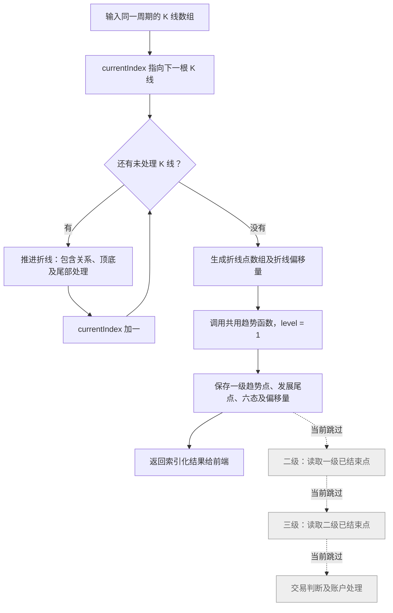
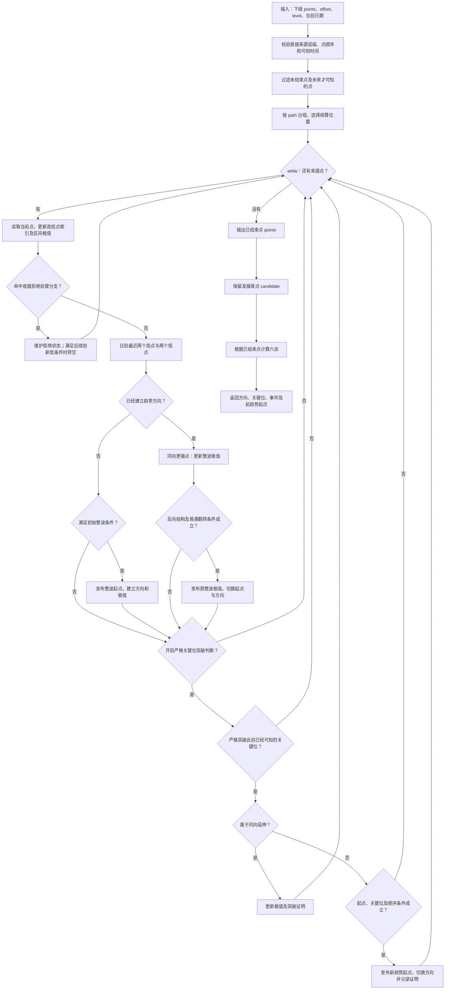
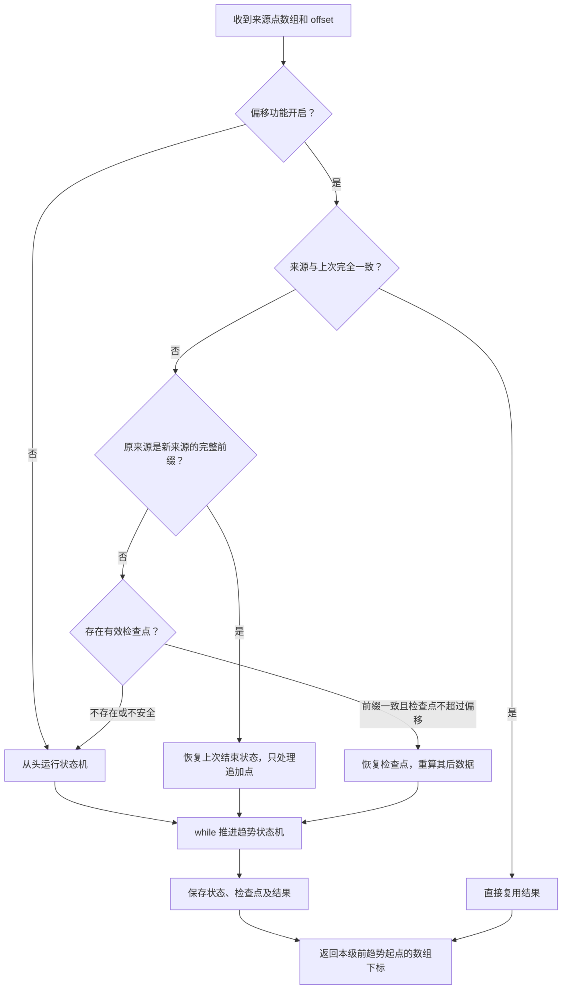
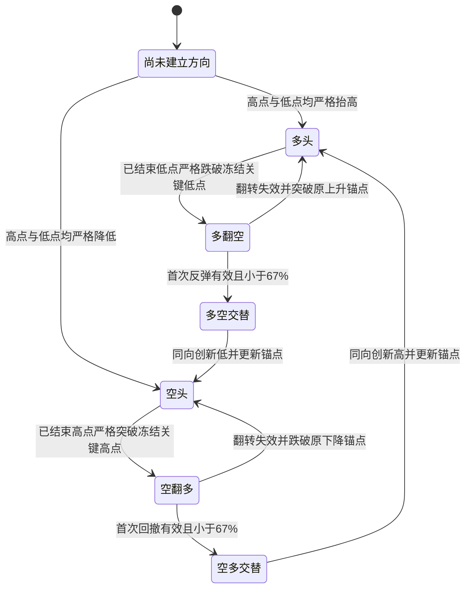
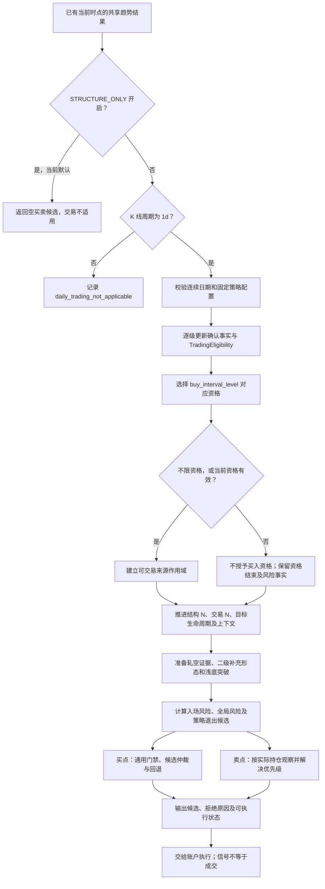
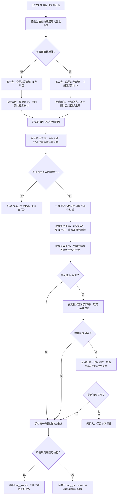
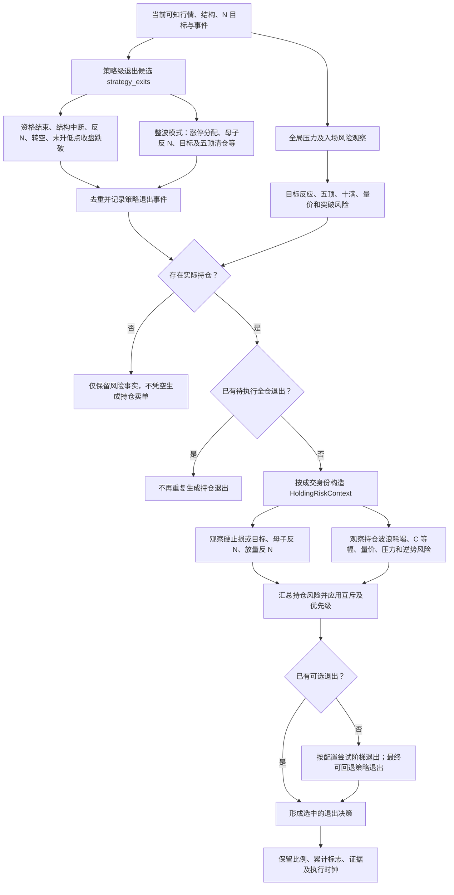
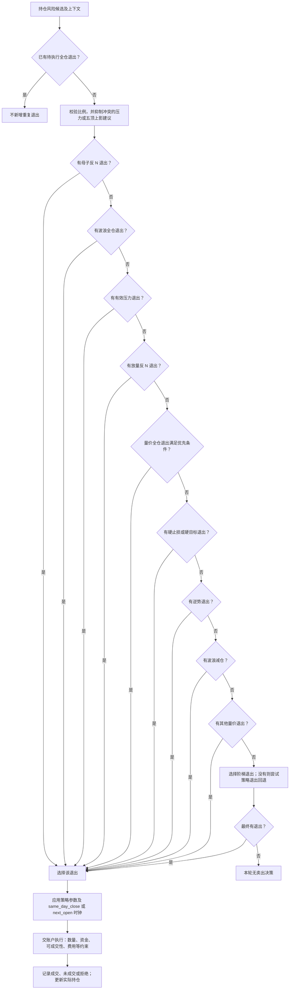

# Rust 趋势、买点与卖点流程

本文说明当前 Rust 实现，供趋势内核、买卖规则、账户执行、调度、接口与展示逻辑的维护者使用。它是本仓库这些 Mermaid 流程图的唯一维护位置。

- 维护责任：修改相关逻辑的开发者在同一变更中同步维护。
- 最近源码核对：2026-10-24；`analyzer::VERSION = 14`。
- 核对方式：阅读下表列出的源码；本次未运行算法测试或 Mermaid 渲染验证。
- 当前范围：`STRUCTURE_ONLY = true`，主流程启用折线和一级，二级、三级及交易停用。图示保留未启用实现，但不表示它们已通过运行验收。

## 源码与图示对应关系

以下路径均相对于仓库根目录；链接不依赖容易漂移的行号。

| 维护内容 | 源码入口 | 需要同步的图与说明 |
| --- | --- | --- |
| 结构模式、数组快速路径、启用层级 | [analyzer.rs](../apps/servers/wavequant-quant-rs/src/analysis/analyzer.rs)、[system.rs](../apps/servers/wavequant-quant-rs/src/analysis/system.rs) | 图一及当前范围 |
| 包含、顶底、折线生命周期 | [drawing.rs](../apps/servers/wavequant-quant-rs/src/analysis/kernel/drawing.rs) | 图一折线节点；改变职责边界时细化说明 |
| 来源过滤、整波、翻转、特殊突破、发展尾部、路径连续性 | [waves.rs](../apps/servers/wavequant-quant-rs/src/analysis/kernel/waves.rs) | 图二、现存等级分支与输入输出 |
| 偏移、检查点、前缀核对、缓存复用 | `analyzer.rs`、`waves.rs`、[arena.rs](../apps/servers/wavequant-quant-rs/src/analysis/kernel/arena.rs) | 图三及偏移坐标说明 |
| 严格高低比较、回撤阈值、六态 | [structure.rs](../apps/servers/wavequant-quant-rs/src/analysis/kernel/structure.rs) | 图二方向判断、图四及边界说明 |
| 方向发布、可选 N 确认 | [publication.rs](../apps/servers/wavequant-quant-rs/src/analysis/kernel/publication.rs)、[n_confirmation.rs](../apps/servers/wavequant-quant-rs/src/analysis/kernel/n_confirmation.rs) | 结构、确认与交易的边界说明 |
| 选项默认值、前端状态投影 | [kernel.rs](../apps/servers/wavequant-quant-rs/src/analysis/kernel.rs)、[trend_state.rs](../apps/servers/wavequant-api-rs/src/application/trend_state.rs) | 当前范围、开关说明及索引输出 |
| 交易入口、资格、N 证据与候选回退 | [trading/day.rs](../apps/servers/wavequant-quant-rs/src/analysis/trading/day.rs)、[trading.rs](../apps/servers/wavequant-quant-rs/src/analysis/trading.rs)、[qualification.rs](../apps/servers/wavequant-quant-rs/src/analysis/trading/qualification.rs) | 图五、图六与资格边界 |
| 两类买点、仲裁、补充及独立买点 | [hierarchy.rs](../apps/servers/wavequant-quant-rs/src/analysis/trading/hierarchy.rs)、[arbiter.rs](../apps/servers/wavequant-quant-rs/src/analysis/trading/arbiter.rs)、[entries.rs](../apps/servers/wavequant-quant-rs/src/analysis/trading/entries.rs)、[secondary.rs](../apps/servers/wavequant-quant-rs/src/analysis/trading/secondary.rs)、[shallow.rs](../apps/servers/wavequant-quant-rs/src/analysis/trading/shallow.rs) | 图六、顺序与阈值 |
| N 来源、轧空与波浪目标 | [candidates.rs](../apps/servers/wavequant-quant-rs/src/analysis/trading/candidates.rs)、[targets.rs](../apps/servers/wavequant-quant-rs/src/analysis/trading/targets.rs)、[target_lifecycle.rs](../apps/servers/wavequant-quant-rs/src/analysis/trading/target_lifecycle.rs)、[squeeze.rs](../apps/servers/wavequant-quant-rs/src/analysis/trading/squeeze.rs)、[waves.rs](../apps/servers/wavequant-quant-rs/src/analysis/trading/waves.rs)、[one_p.rs](../apps/servers/wavequant-quant-rs/src/analysis/trading/one_p.rs) | 图五、图六、图七中的来源与风险分支 |
| 卖点、持仓风险、退出优先级 | [risk.rs](../apps/servers/wavequant-quant-rs/src/analysis/trading/risk.rs)、[entry_risk.rs](../apps/servers/wavequant-quant-rs/src/analysis/trading/entry_risk.rs)、[exits.rs](../apps/servers/wavequant-quant-rs/src/analysis/trading/exits.rs)、[intraday.rs](../apps/servers/wavequant-quant-rs/src/analysis/intraday.rs) | 图七、图八与执行时钟 |
| 策略选项与信号落地 | [config.rs](../apps/servers/wavequant-quant-rs/src/analysis/trading/config.rs)、[profiles.rs](../apps/servers/wavequant-quant-rs/src/analysis/profiles.rs)、[system.rs](../apps/servers/wavequant-quant-rs/src/analysis/system.rs)、[execution](../apps/servers/wavequant-quant-rs/src/execution/) | 图五至图八、默认值与成交边界 |

## 图一：当前主流程

此图描述 `STRUCTURE_ONLY` 且 `pivot_mode = lecture_causal` 的数组快速路径：先逐根推进折线，再汇总并计算一级。`system.rs` 中的结构模式入口调用 `advance_polyline_index`、`finish_polyline_array`、`finish_first_level_array`。其他入口仍可能走逐日 `process_next / prepare_structure`，不得把此快速路径描述成所有入口的唯一调度方式。

实线为当前执行路径，虚线为已实现但当前跳过的后续层级。

`level` 与 `timeframe` 独立：同一份日线、周线或月线，各自形成折线及三级趋势。一级输入折线，二级输入一级，三级输入二级，不在层级之间切换周期。当前前端状态投影的 `enabled` 为 `[true, true, false, false]`。

完整调度实现还保留方向确认、上级严格突破回执及来源版本变化后的收敛重算；这些不在当前数组快速路径中执行。未来启用时，应在此图补充其实际执行顺序，不能只把虚线换成实线。

## 图二：共用趋势判断

`TrendCursor` 校验和过滤来源后按 `path` 分组，各组的 `PathCursor` 调用 `path_trend`。图中循环遍历直接下级点数组；已结束且在当前时点可知的点才可进入判断，动态尾点不能成为下一级闭合证据。

### 判断边界与当前选项

- 最近两个高点与两个低点全部严格抬高，得到上升方向；全部严格降低，得到下降方向。相等或方向不一致时，这次比较不能建立方向。
- 普通翻转还需反向结构、整波及旧关键位等条件。`ordinary_trend_completion_enabled` 默认关闭，仅表示不开放该选项控制的放宽条件，不等于关闭所有普通翻转。
- `secondary_reversal_enabled` 默认开启，控制严格关键位突破处理；名称中的 secondary 不代表二级趋势的启用开关。
- `known_index` 是最早可知 K 线位置，与点所在的 K 线位置独立；严格突破要求关键位在攻击点发生前已经可知。
- 各路径分开运行后，`compute_indices` 仍有受限的来源点连续性桥接。图二概括单路径状态机，不把不同路径无条件相连；改动桥接规则时同步补图或说明。

### 当前仍存在的等级分支

三个等级共用函数，但当前 `waves.rs` 内仍有以下判定差异。这是对现状的记录，不是对这些差异的批准，也不替代根 `AGENTS.md` 的多级统一规则。

1. `level > 1` 时，上升过程的特定创新高可能进入收盘拒绝分支，再等待后续创新低处理。
2. 初始整波判断使用 `level == 1 || end > start + 1`。
3. 普通翻转使用 `level == 1 || counter > peak + 1`。

本次仅整理文档，未修改上述判定。

## 图三：偏移与增量续算

输入偏移是直接下级上一个趋势起点在下级数组中的位置；输出偏移是本级上一个趋势起点在本级数组中的位置。例如二级读取一级数组下标，返回供三级使用的二级数组下标。它们不能与 K 线 `barIndex`、点池 `PointId` 或下一根 K 线 `currentIndex` 混用。

`trend_offset_enabled` 默认开启。检查点恢复须核对保留前缀；早期修订不能靠偏移跳过。没有前趋势起点时偏移为零。路径分组时，全局数组偏移会转换为各路径中符合来源条件的点数量。

偏移减少的是趋势状态机重复推进；来源比较、校验、分组、部分六态及确认处理仍可能扫描列表。完整调度入口 `execute_level_from` 仍复制点引用列表，并不等于重新复制完整行情；当前一级数组快速路径直接传递点号数组。不能将其描述为全流程完全不扫描前缀或没有任何分配。

## 图四：六态主要转换

六态使用已结束点。图示为主要转换，未画出的输入通常保留当前状态；“头部疑虑”和“底部疑虑”是事件，不是新增的第七、第八种状态。

有效回撤要求反向运动大于零且小于原推动幅度，交替还要求严格小于 `0.67`；等于 67% 不满足。小于 `0.33` 会记录弱反向运动证据，不另增一种六态。首次回撤不满足交替条件，不会直接确认反向趋势；攻击点后续延伸时，代码可更新攻击起点、极值并重新等待回撤。

## 结构、方向确认、交易与前端索引

- `points`：已结束结构点，供直接上一级计算。
- `candidate`：发展尾点，不授予上一级闭合证据。
- `publication`：方向确认记录，与原始结构分开；完整调度中的 `refresh_publication` 可参考下级确认与可选 N 证明。当前一级数组快速路径没有额外调用这一步。
- 交易资格与账户：另行处理，当前停用。六态或方向确认不能直接等同于成交。
- 面向前端的折线点使用 `barIndex`；趋势点使用直接下级数组的 `sourceIndex`，并带 `knownIndex`、`confirmed`。路径或仅供引用的点还可带 `path`、`referenceOnly`。行情由独立接口返回，以 `dataVersion` 防止索引错位。

## 图五：买卖判断的入口与资格

以下四张图记录保留在代码中的完整交易逻辑。当前 `STRUCTURE_ONLY = true` 时不会进入这些规则，结构模式返回空交易结果；文档补充不代表已开启交易。

- `buy_interval_level = 0` 表示不限资格，1/2/3 表示选择对应趋势资格；它不是折线层级，也不是 K 线周期。
- 日线资格与趋势六态分别维护。完整调度中，区间开启/结束、确认缺口、来源路径等均保留事件；不能只凭前端显示“多头”授予买入资格。
- 资格外不会因为仍有候选形态而自动获得买入许可。资格结束本身还可能产生退出候选；具体执行时钟与持仓状态仍由后续链处理。
- N 来源及其 `scope`、首次可知时间、失效和退役共同决定候选可用性，不能把图中的“推进 N”理解为扫描整段未来行情。

## 图六：买点生成、筛选与回退顺序

图示以草稿使用的 `lecture()` 配置为主：`whole_flip_wave_v3` 与 `hierarchical_two_buy_points`。兼容策略 `legacy_v2`、`transitioned_squeeze` 等保留独立配置分支，不能将下面的两类买点阈值套用到全部策略。

### 两类层级买点的当前边界

共同前提包括来源可知、上下文仍有效、原始起点没有被跌破，以及交替/N 的时间顺序成立。部分同一 N 参与交替确认的情形使用 `joint` 证明，不应误写为所有情况都要求交替严格早于 N。

| 类型 | 当前主要条件 | 基础配置与边界 |
| --- | --- | --- |
| 第一类 `transition_squeeze` | N 攻击前尚未成熟；通常要求二/三级，显式选一级资格时允许一级；交替后新正 N 与轧空证据 | `first_pullback_threshold` 基础为 0.5，开启时回调必须严格大于门槛；可按交替低点或指定区间最低收盘测量；`None` 表示关闭深度过滤 |
| 第二类 `mature_shallow_squeeze` | 已成熟，峰值严格高于翻多高点，峰值、回调低点、N 攻击次序成立 | 回调以峰值至当前最低收盘、相对峰值到原点的幅度计算；基础上限为精确 1/3，基础配置允许等于上限 |

层级选择先比较买点优先级，再比较趋势级别；第二类的 `priority = 2`，第一类为 1。主 N 仲裁还按层级优先级、重新确认/波浪标记、攻击位置的元组倒序检查，并返回首条通过者；不能解释成所有买点同时触发或只挑最新日期。

### 通用门禁与候选过滤

`prepare_trading_day` 在主候选及两条回退链之前依次汇总以下拒绝原因，使用首个命中的原因记录：

1. 放量长上影；整波模式下的放量阴线、反 N 低点及折线门禁限制。
2. 缺口门禁、十满暂停、二吐风险；整波模式的一饱突破观察限制。
3. 当日已有策略退出候选时，阻止同日策略买入。

主候选内还检查有效作用域与轧空轮次、N 失效/退役、二级阻力和反向 N 的恢复证据、原 N 收盘约束、行情状态、量能、止损和结构目标。部分检查受策略配置或特定证明豁免，图中聚合节点不表示这些条件在全部策略下一律同时开启。

基础参数 `minimum_rvol = 1.2`、`minimum_reward_risk = 1.5` 由配置和 profile 决定；整波模式的量能判断并非统一使用 1.2 倍，而有相对前一根或 N 前参考量等专用条件。收盘毛盈亏比预检是可配置条件，实际成交时的价格、费用及净盈亏比不能用它替代。

### 回退候选及执行模型

只有通用门禁未命中且主 N 没有结果，才按以下顺序进入补充形态；每条还需自己的证据、去重、风险和盈亏比条件，并由相关开关控制：

1. 组合 A 回调突破 `combined_a_pullback_breakout`。
2. 二级深回调收复 `secondary_deep_pullback_reclaim`。
3. 二级阻力收复 `secondary_resistance_reclaim`。
4. 待选交替浅底突破 `shallow_base_breakout`。

基础 `TradingDayConfig` 中前三条相关开关为 false，浅底开关为 true；profile 或请求可以改变这些值，不代表当前结构模式在执行它们。

仍无候选，且没有目标/五顶风险时，检查资格内三种独立收盘买点：突破后次日放量跳空守稳、倍量中大阳高位收盘突破、放量高开高走。它们还需有效资格、折线门禁、冻结防守位及一饱/二吐过滤。

主 N 与补充形态候选的基础 `execution_model` 为 `next_open`；独立资格买点为 `same_day_close`。账户装配仍可能按执行参数转换，不得由信号倒推到更早分钟成交。

## 图七：卖点与风险决策的来源

卖点候选来自策略级和实际持仓级两条链，之后才仲裁。不同风险可能要求清仓、比例减仓或累计目标减仓；同名比例也不一定有相同计量语义。

- `strategy_exits` 的整波专用分支包括涨停分配、母子反 N 低点、C 等幅及五顶的特定清仓形态；其他分支包括反 N、新转空事件、资格结束和末升低点收盘跌破。并不是所有目标到达都会立即卖出。
- `entry_risk.rs` 维护目标、五顶、十满相关状态。二吐等目标后的放量阴线、长上影、后续确认可能生成不同的减仓/清仓建议；这些建议还会约束新买入。
- `evaluate_holding_risks` 使用真实入场/信号时间、已减仓标志、持仓关联波浪、压力警告与策略开关；不把入场前全部风险直接视为持仓卖点。
- 某些规则依赖分钟行情；分钟缺失时只有显式开启相应日线回退才使用日线模型，并记录回退证据。不能把日线识别时间当作已经完成的分钟成交。
- `strategy_exits` 内部还对五顶清仓候选排序与去重，随后持仓仲裁有自己的优先级。不能按列表顺序直接执行所有卖点。

## 图八：退出优先级与账户落地

下面是 `risk::resolve_exit_precedence` 的选择顺序。先进行特定风险之间的冲突抑制，再按序取第一个有效候选；不使用“谁的卖出比例最大就选谁”的通用排序。

量价全仓优先条件为：没有逆势退出，或者量价原因是 `volume_upper_shadow_next_open_decline_clear`。特定量价事件还会在前置冲突处理中抑制较弱压力/波浪建议；因此图中“压力优先”不表示所有原始压力事件无条件优先。

`system.rs` 先合并分钟决策，随后处理持仓退出；存在进入或退出决策时，不再从当日日线候选重复开仓。仅当没有这些决策时，日线候选还需 `fully_executable`，持仓加仓需允许 `allow_add_on`，也可能只抬高止损。选中的日线买点或卖点仍要经过执行模型与账户处理，不能把 `long_signal`、`exit_signal` 或 `RuleDecision` 直接标为成交。

### 本节覆盖边界

图五至图八是当前完整交易实现的入口、分支和仲裁总览，不逐条复制所有烛形公式、分钟撮合及持仓比例公式。叶子条件以对应源码为准；新增、删除或改动会改变买卖结果的叶子规则时，须同步相关图或在对应说明中明确记录。当前交易停用，本次未执行回测、交易链或 Mermaid 渲染验收。

## 后续同步维护要求

1. 改动上表涉及的实际行为、启用开关、默认选项、循环顺序、偏移恢复条件、阈值或输入输出语义时，必须在同一变更中更新对应 Mermaid、说明及最近源码核对日期；图示不能仅写计划行为。
2. 启用或停用二级、三级、交易，或改变逐日与数组快速路径时，必须更新图一、当前范围和前端 `enabled` 的说明。
3. 调整普通/特殊翻转、等级分支、确认来源、连续性或回撤边界时，同步核对图二、图四。修正源码已有差异后删除过时现状说明，不能只更新日期。
4. 买点资格、两类入场阈值、通用门禁、候选排序/回退、卖点风险及退出优先级、减仓语义或执行时钟变更时，必须同步图五至图八和对应源码映射；不能只维护趋势图。
5. 纯命名或文件迁移而未改变行为时更新源码映射；不为凑改动重画无变化的流程。
6. 按仓库规定的开发/提交验证节奏执行必要检查；未运行的渲染或行为验证如实记录为待验证，不因维护文档自行启动测试、浏览器或构建。
7. 图示依靠人工随代码维护，不是从 AST 自动生成，也没有新增自动一致性门禁。评审相关逻辑变更时必须核对本文是否同步。

## 维护记录

| 日期 | 变更 | 证据边界 |
| --- | --- | --- |
| 2026-10-24 | 首次整理四张 Mermaid、源码映射、当前停用范围及同步维护要求 | 源码阅读；未运行算法、渲染、测试或构建 |
| 2026-10-24 | 补充交易资格、买点筛选与回退、卖点来源、退出优先级四张图及账户边界 | 阅读Rust源码；当前交易停用，未运行算法或渲染验证 |
