# Rust 趋势、买点与卖点流程

本文说明当前 Rust 实现，供趋势内核、买卖规则、账户执行、调度、接口与展示逻辑的维护者使用。它是本仓库这些 Mermaid 流程图的唯一维护位置。

- 维护责任：修改相关逻辑的开发者在同一变更中同步维护。
- 最近源码核对：2026-10-26；`analyzer::VERSION = 30`。
- 本轮 v29 核对方式：代码阅读、必要启动编译/重启；随后按用户明确要求，对国芳集团2135根冻结日线运行资格成本三组离线对照，各预热3次、独立进程轮换采样9次。纯趋势27.4851ms、N维护资格关41.0281ms、二级资格开44.4290ms；完整四级结构及开关前后N数据一致。见[v29资格成本](diagnostics/qualification-cost-v29-2026-10-26.md)。测试套件、浏览器、Mermaid渲染和旧Python等价核对未执行；v27/v28旧计时不能作为v29证据。
- 当前范围：`STRUCTURE_ONLY = true`，主流程启用折线及一、二、三级；本级买点开关开启后计算资格区间，买卖与账户执行仍停用。图示保留未启用实现，但不表示它们已通过运行验收。

详细确认规则见下方《空多交替结束确认通道详解（v27）》：四条通道、六张细分 Mermaid、阈值及返回边界。

## 源码与图示对应关系

以下路径均相对于仓库根目录；链接不依赖容易漂移的行号。

| 维护内容 | 源码入口 | 需要同步的图与说明 |
| --- | --- | --- |
| 结构模式、数组快速路径、启用层级 | [analyzer.rs](../apps/servers/wavequant-quant-rs/src/analysis/analyzer.rs)、[system.rs](../apps/servers/wavequant-quant-rs/src/analysis/system.rs) | 图一及当前范围 |
| 包含、顶底、折线生命周期 | [drawing.rs](../apps/servers/wavequant-quant-rs/src/analysis/kernel/drawing.rs) | 图一折线节点；改变职责边界时细化说明 |
| 来源过滤、整波、翻转、特殊突破、发展尾部、路径连续性 | [waves.rs](../apps/servers/wavequant-quant-rs/src/analysis/kernel/waves.rs) | 图二、现存等级分支与输入输出 |
| 偏移、检查点、前缀核对、缓存复用 | `analyzer.rs`、`waves.rs`、[arena.rs](../apps/servers/wavequant-quant-rs/src/analysis/kernel/arena.rs) | 图三及偏移坐标说明 |
| 严格高低比较、回撤阈值、六态 | [structure.rs](../apps/servers/wavequant-quant-rs/src/analysis/kernel/structure.rs) | 图二方向判断、图四及边界说明 |
| 方向发布、可选 N 确认 | [publication.rs](../apps/servers/wavequant-quant-rs/src/analysis/kernel/publication.rs)、[n_confirmation.rs](../apps/servers/wavequant-quant-rs/src/analysis/kernel/n_confirmation.rs) | 结构、确认与交易的边界说明 |
| 选项默认值、前端状态投影 | [kernel.rs](../apps/servers/wavequant-quant-rs/src/analysis/kernel.rs)、[trend_state.rs](../apps/servers/wavequant-api-rs/src/application/trend_state.rs) | 当前范围、开关说明及索引输出 |
| 资格确认四通道 | [eligibility.rs](../apps/servers/wavequant-quant-rs/src/analysis/kernel/eligibility.rs)、[single_n.rs](../apps/servers/wavequant-quant-rs/src/analysis/trading/single_n.rs)、[n_alternation.rs](../apps/servers/wavequant-quant-rs/src/analysis/trading/n_alternation.rs)、两份 confirmation.rs | 确认通道详解与六张细分图 |
| 交易入口、资格、N 证据与候选回退 | [trading/day.rs](../apps/servers/wavequant-quant-rs/src/analysis/trading/day.rs)、[trading.rs](../apps/servers/wavequant-quant-rs/src/analysis/trading.rs)、[qualification.rs](../apps/servers/wavequant-quant-rs/src/analysis/trading/qualification.rs) | 图五、图六与资格边界 |
| 两类买点、仲裁、补充及独立买点 | [hierarchy.rs](../apps/servers/wavequant-quant-rs/src/analysis/trading/hierarchy.rs)、[arbiter.rs](../apps/servers/wavequant-quant-rs/src/analysis/trading/arbiter.rs)、[entries.rs](../apps/servers/wavequant-quant-rs/src/analysis/trading/entries.rs)、[secondary.rs](../apps/servers/wavequant-quant-rs/src/analysis/trading/secondary.rs)、[shallow.rs](../apps/servers/wavequant-quant-rs/src/analysis/trading/shallow.rs) | 图六、顺序与阈值 |
| N 来源、轧空与波浪目标 | [candidates.rs](../apps/servers/wavequant-quant-rs/src/analysis/trading/candidates.rs)、[targets.rs](../apps/servers/wavequant-quant-rs/src/analysis/trading/targets.rs)、[target_lifecycle.rs](../apps/servers/wavequant-quant-rs/src/analysis/trading/target_lifecycle.rs)、[squeeze.rs](../apps/servers/wavequant-quant-rs/src/analysis/trading/squeeze.rs)、[waves.rs](../apps/servers/wavequant-quant-rs/src/analysis/trading/waves.rs)、[one_p.rs](../apps/servers/wavequant-quant-rs/src/analysis/trading/one_p.rs) | 图五、图六、图七中的来源与风险分支 |
| 卖点、持仓风险、退出优先级 | [risk.rs](../apps/servers/wavequant-quant-rs/src/analysis/trading/risk.rs)、[entry_risk.rs](../apps/servers/wavequant-quant-rs/src/analysis/trading/entry_risk.rs)、[exits.rs](../apps/servers/wavequant-quant-rs/src/analysis/trading/exits.rs)、[intraday.rs](../apps/servers/wavequant-quant-rs/src/analysis/intraday.rs) | 图七、图八与执行时钟 |
| 策略选项与信号落地 | [config.rs](../apps/servers/wavequant-quant-rs/src/analysis/trading/config.rs)、[profiles.rs](../apps/servers/wavequant-quant-rs/src/analysis/profiles.rs)、[system.rs](../apps/servers/wavequant-quant-rs/src/analysis/system.rs)、[execution](../apps/servers/wavequant-quant-rs/src/execution/) | 图五至图八、默认值与成交边界 |

## 图一：当前主流程

此图描述 `STRUCTURE_ONLY` 且 `pivot_mode = lecture_causal` 的数组快速路径：先逐根推进折线，再汇总并依次计算一级、二级、三级。`system.rs` 中的结构模式入口调用 `advance_polyline_index`、`finish_polyline_array`、`finish_level_array(level)`。其他入口仍可能走逐日 `process_next / prepare_structure`，不得把此快速路径描述成所有入口的唯一调度方式。

实线为当前结构执行路径，交易保持停用。

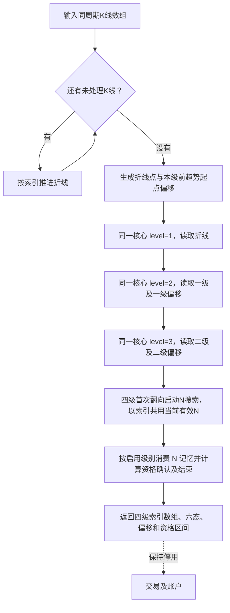

`level` 与 `timeframe` 独立：同一份日线、周线或月线，各自形成折线及三级趋势。一级输入折线，二级输入一级，三级输入二级，不在层级之间切换周期。当前前端状态投影的 `enabled` 为 `[true, true, true, true]`。

完整调度实现还保留方向确认、上级严格突破回执及来源版本变化后的收敛重算；这些不在当前数组快速路径中执行。未来启用时，应在此图补充其实际执行顺序，不能只把虚线换成实线。

## 图二：共用趋势判断

`TrendCursor` 校验和过滤来源后按 `path` 分组，各组的 `PathCursor` 调用 `path_trend`。图中循环遍历直接下级点数组；已结束且在当前时点可知的点才可进入判断，动态尾点不能成为下一级闭合证据。

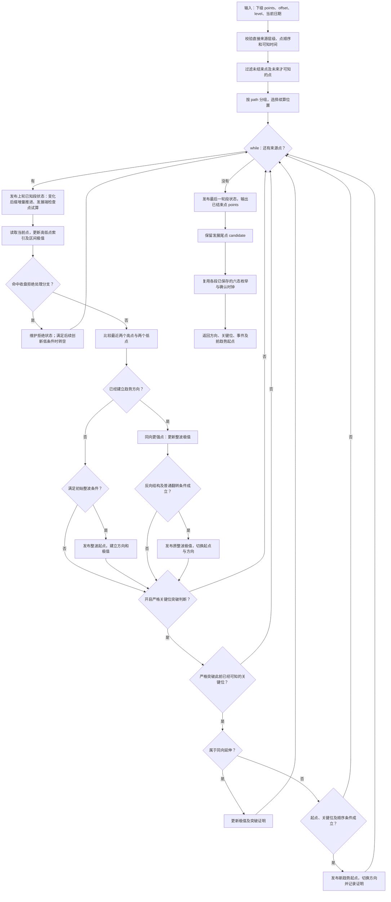

### 判断边界与当前选项

- 最近两个高点与两个低点全部严格抬高，得到上升方向；全部严格降低，得到下降方向。相等或方向不一致时，这次比较不能建立方向。
- 普通翻转还需反向结构、整波及旧关键位等条件。`ordinary_trend_completion_enabled` 默认关闭，仅表示不开放该选项控制的放宽条件，不等于关闭所有普通翻转。
- `secondary_reversal_enabled` 默认开启，控制严格关键位突破处理；名称中的 secondary 不代表二级趋势的启用开关。
- `known_index` 是最早可知 K 线位置，与点所在的 K 线位置独立；严格突破要求关键位在攻击点发生前已经可知。
- 各路径分开运行后，`compute_indices` 仍有受限的来源点连续性桥接。图二概括单路径状态机，不把不同路径无条件相连；改动桥接规则时同步补图或说明。

### 当前仍存在的等级分支

三个等级共用函数，但当前 `waves.rs` 内仍有以下判定差异。这是对现状的记录，不是对这些差异的批准，也不替代根 `AGENTS.md` 的多级统一规则。

1. `level > 1` 时，上升过程的特定创新高可能进入收盘拒绝分支，再等待后续创新低处理。
2. 初始整波判断使用 `level == 1 || end > start + 1`。
3. 普通翻转使用 `level == 1 || counter > peak + 1`。

本次仅整理文档，未修改上述判定。

## 图三：偏移与增量续算

输入偏移是直接下级上一个趋势起点在下级数组中的位置；输出偏移是本级上一个趋势起点在本级数组中的位置。例如二级读取一级数组下标，返回供三级使用的二级数组下标。它们不能与 K 线 `barIndex`、点池 `PointId` 或下一根 K 线 `currentIndex` 混用。

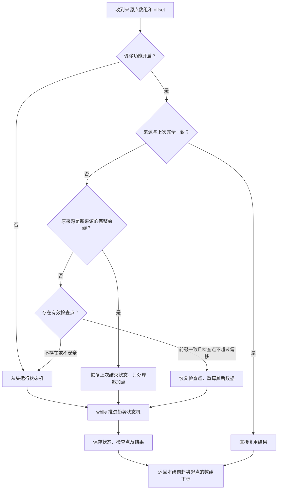

`trend_offset_enabled` 默认开启。检查点恢复须核对保留前缀；早期修订不能靠偏移跳过。没有前趋势起点时偏移为零。路径分组时，全局数组偏移会转换为各路径中符合来源条件的点数量。

偏移减少的是趋势状态机重复推进；来源比较、校验、分组、部分六态及确认处理仍可能扫描列表。完整调度入口 `execute_level_from` 仍复制点引用列表，并不等于重新复制完整行情；当前一级数组快速路径直接传递点号数组。不能将其描述为全流程完全不扫描前缀或没有任何分配。

## 图四：六态主要转换

六态使用已结束点。图示为主要转换，未画出的输入通常保留当前状态；“头部疑虑”和“底部疑虑”是事件，不是新增的第七、第八种状态。

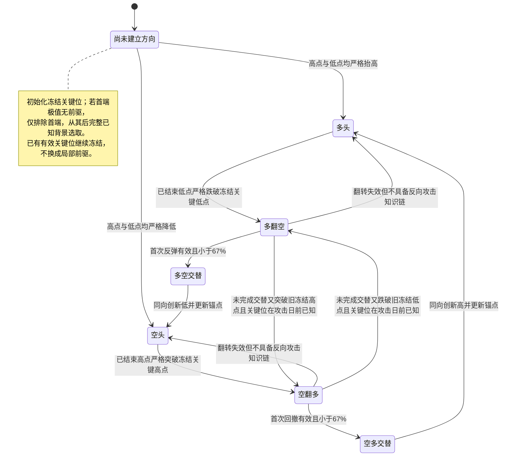

有效回撤要求反向运动大于零且小于原推动幅度，交替还要求严格小于 `0.67`；等于 67% 不满足。小于 `0.33` 会记录弱反向运动证据，不另增一种六态。首次回撤不满足交替条件，不会直接确认反向趋势；攻击点后续延伸时重新等待回撤；翻多保留整段冻结最低起点，仅更新攻击高点，翻空沿用前驱更新规则。

## 结构、方向确认、交易与前端索引

- `points`：已结束结构点，供直接上一级计算。
- `candidate`：发展尾点，不授予上一级闭合证据。
- `publication`：方向确认记录，与原始结构分开；完整调度中的 `refresh_publication` 可参考下级确认与可选 N 证明。当前一级数组快速路径没有额外调用这一步。
- 交易资格：按本级开关另行确认并返回区间；买卖与账户执行仍停用。六态或方向确认不能直接等同于资格或成交。
- 面向前端的折线点使用 `barIndex`；趋势点使用直接下级数组的 `sourceIndex`，并带 `knownIndex`、`confirmed`。路径或仅供引用的点还可带 `path`、`referenceOnly`。行情由独立接口返回，以 `dataVersion` 防止索引错位。

v25 补齐旧 Python lecture_trend._initial_context_key 的首端无前驱回退，以及翻多整波起点冻结。一个无前驱的历史最高/最低点不能令 key 永久为空并吞掉后续翻向；该修复适用于所有股票和一、二、三级共用函数，不新增股票、日期或等级特例，不重画趋势点。国芳集团经本轮授权单次页面计算，v25 返回 5 条二级记录，其中 1 条确认当日结束，图表显示 4 段有效资格区域。修复前后同一行情版本、完整四级点数组一致；已核对历史及最新图窗的淡红背景。各股票共用本规则，但该单股证据不代表全市场已验证。

## 图四补充：空多交替结束确认与交易资格区间

统一实现位于 [kernel/eligibility.rs](../apps/servers/wavequant-quant-rs/src/analysis/kernel/eligibility.rs)，由 finish_qualification_arrays 消费同次四级趋势结果与六态历史时钟。三个等级共用同一个资格流程；不重新识别趋势、不展开递归证明。

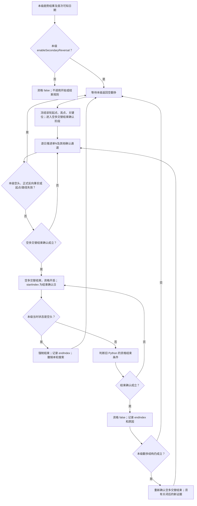

- 空翻多与本级开关只允许进入 AwaitingAlternationEnd，不能直接授予资格。该阶段逐日确认空多交替是否结束，不要求以后每一天仍标成空翻多；进入空多交替或多头的六态标签也不能代替结束确认；资格尚未开始，不调用区间结束规则。空头或已失效候选直接撤销，不伪造一条结束记录。
- 空多交替结束确认成立才进入 Active，交易资格从该结束确认日开启并画区间。仅 Active 可执行结束规则，确认当日即可执行；本级六态为 Bear/空头必须关闭并退出该轮，不能在后续多头日用旧种子重开。六态沿用趋势函数保存的当时观察状态，缺少观察历史的兼容帧才读取 RefContext.state，不由资格消费者重新判趋势。
- v26按用户新方案改造N通道；独立量价、缺口及普通确认保留。其他确认规则参考 Python bull_alternation_confirmation.confirm_bull_alternation：冻结起点守住后，普通严格小于2/3回撤、深回撤后高点重突破、短浅回撤时间门槛，以及 N/轧空、量价、实体跳空确认。普通确认与兼容生命周期共用函数；不把六态的67%当作资格阈值。
- 结束规则参考 Python TradingEligibility.observe / close_on_reversal_low_break / close_on_confirmation_gap_fill 和 confirmed_source_bear：本级正式冻结末升低破位、已确认多空交替、本级空头、直接来源正式空头/破位、本级最新已知反转低点破位、起点失效和来源路径结束。正式翻空必须使用攻击日前已知的冻结关键位；候选标签不替代正式破位证据。
- 依赖缺口的资格只在 now > startIndex 后检查缺口回补，与 Python 一致；其他结束条件在确认当日也检查。独立确认可解除既有窗口的缺口依赖，不重置开始日期、不另开区间。
- 关闭后沿用 Python TrendLifecycle.resume_qualification_search：本级翻多结构仍成立才回到 AwaitingAlternationEnd { after: endIndex }；普通确认先排除关闭前已经可知的旧低点，再选新的最低点，v27 资格关闭不再清理 N 记忆；N通道重开仍须有关闭后才确认的轧空；普通通道过滤旧低点，量价及实体缺口的重开边界详见四通道说明。本级空头、正式反向或起点/路径失效则等待新的空翻多。
- 默认开关 [false,false,true,false]。现有前端“买点筛选级别”由 API 映射为仅该级开启，分析配置支持独立开启各级；买卖与账户继续停用。
- DTO 保持 state.qualification = { enabled, active, intervals }，每个区间仅含 path/startIndex/lowIndex/endIndex/confirmationRule/endReason。所有索引属于匹配 dataVersion 的独立行情数组；不添加K线、趋势副本或证据树。
- 区间语义为 [startIndex,endIndex)，null终点表示仍有效。淡红色显示有效日期，淡蓝色显示确认/结束边界；同日确认并结束只显示边界。结构低点 lowIndex 不倒填成开始日期。
- v23的失败翻向反向攻击修复保留，v24仅在原六态输出上记录历史状态供资格门禁消费；不改变趋势点坐标和判定规则。连续性桥接同步路径标识，状态与返回点属于同一路径。
- 当前结构数组入口使用本流程；停用的账户链不据此视为完成迁移或等价验收。level0..3.qualification与qualification_total计时保留。v27 各方向候选按本段趋势起点之后的来源下标只向后推进，资格另限制 N 的 A 必须在空翻多高点后，不枚举120日候选；普通/外层回撤和结束条件仍可能扫描历史，不能声称整个资格流程均为严格线性。
- v24新增分阶段、延迟确认、空头强制结束、新证据重开和正式破位时钟回归源码；本轮未运行测试/回测/浏览器，实际区间与Python全量等价仍待验证。v23图上5段的旧联调记录不代表v24验收。

## 单 N 状态机与资格复用（v27）

v26 将 N 通道改成单候选；v27 扩展为关键位周期内各趋势的正反首 N 记忆。资格通道仍只接受空翻多攻击高点之后的有效正 N，并保留独立量价、实体缺口和普通回撤确认。此次没有运行结果及性能对照，不能将旧版计时当作本轮性能或 Python 等价证据。

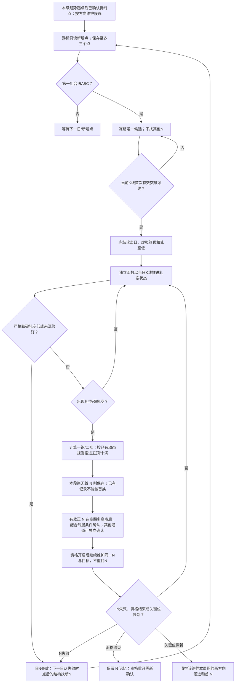

- v29运行入口 `trading/single_n.rs::advance_n_indexed` 输入共享折线点数组、一次准备的价格和K线数组下标；颈线收盘通过数组下标只读取一次。返回ABC各自来源数组下标/K线下标/可知时钟、颈线极值及收盘、攻击日、轧空低、箱顶和失效状态。只保留三个准备点和一个候选，不持有历史行情副本。
- `advance_squeeze_indexed` 输入共享N数据及K线数组，以当前/上一根/攻击K线下标读取固定大小状态；每个新交易日最多推进一次，最早攻击后第二日确认。相等不算破位；严格跌破防守位后整组失效，不再以放量反转复活该N。已有候选不被更晚的ABC替换。
- 出现轧空后才初始化目标。一饱/二吐复用 `project_n_targets`；五顶/十满复用 `waves::ProjectionState::advance_bar` 的动态回调、推动和叠加规则，未具备条件时保留null，不伪造固定价格。目标到达日从轧空可知日开始记录，不倒填历史；每步丢弃临时目标事件，不保留目标临时事件列表；首 N 集合随本周期实际趋势数增长，关键位换新后清空。
- 同一共享N每天最多一次 `advance_n_indexed`，各级只在本趋势首次翻向后持有一个当前有效索引，N维护不依赖资格开关；锁定后只推进防守、轧空及目标。资格消费者不再另算 N。其他确认通道仍按原优先级N→独立量价→实体缺口→普通确认执行；买卖账户仍停用。单N数据是函数内部返回模型，本轮未扩展前端DTO或新增目标图层。
- 来源修订以已保存的三个直接来源下标检查；若坐标、价格、路径或可知时钟改变，候选失效。不能从最终点快照反推所有历史修订，此轮没有修复该既有历史输入缺口。
- 用户授权同海洋王2133根K线、旧→新各预热1次/测量5次：资格中位2316.5288→6.7525ms，分析2342.1111→35.5593ms；四级结构摘要一致，资格12→10条（6段非零），不宣称资格等价。新N日推进614次、轧空284次；旧observe_n重算10360次已从该资格通道移除。报告为本worktree .codex-runtime/rust-startup/single-n-comparison.md。默认API已重新编译并启动；提交前已运行单N、防守、来源修订、同日限制及投射边界回归；不沿用旧规则测试作为新规则正确性证据。

## 空多交替结束确认通道详解（v27）

本节面向规则维护和前后端联调，描述当前 `finish_qualification_arrays → eligibility::calculate` 数组入口。维护者为修改资格规则的开发者；核对日期 2026-10-25。通道、阈值及图示须随代码同步更新，不代表与旧 Python 已完全等价。

### 公共入口、符号与优先级

本级 `enableSecondaryReversal[level] = true` 才计算资格，默认 `[false,false,true,false]`，依次为折线、一级、二级、三级。各级共用流程，N 读取映射到同路径的技术折线，等级不代表日/周/月周期。

| 符号 | 含义 |
| --- | --- |
| O/o、H/h、K/k | 空翻多起点、攻击高点、被突破关键高点的价格/行情下标 |
| L/l | 外层回调低点价格/下标，具体选点来源因通道而异 |
| Q/q | h+1 至 l 的最低收盘价/下标 |
| D、TA、TB | 上涨幅度 H-O，上涨时长 h-o，回调时长 l-h；时长按交易 K 线计 |
| nA/nB/nC | 内部 N 的低、高、低三个折线点，区别于外层 O/H/L |
| t、s、after | 当前日、N 攻击日、上一段资格结束日；首次确认无 after |

合法空翻多种子要求 O/H/K 同级同路径、已确认，`k < o < h`、`O < K < H`，关键位在攻击日之前已可知，其余种子信息不晚于事件可知日，O 后至当前未跌破 O。六态时钟必须实际出现本轮空翻多，同日先空翻多后交替也允许。只进入等待，不直接开启资格。

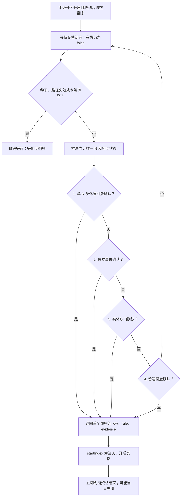

四个通道按序尝试，任一成功即可，不是四个必须同时成立。已有缺口资格寻找独立替代证据时跳过缺口通道，其余顺序不变。

| 顺序 | 函数 | confirmationRule |
| --- | --- | --- |
| 1 | n_alternation::confirm_single_n | single_n_and_squeeze_after_qualified_b |
| 2 | confirmation::confirm_volume_breakout_alternation，参数 confirmed_n_squeeze=false | volume_bullish_polyline_last_fall_high_breakout |
| 3 | confirmation::confirm_body_gap_alternation | body_gap_volume_bullish_breakout_after_defended_low |
| 4 | kernel::confirmation::confirm_ordinary_bull_counter_after | confirmed_higher_pullback_strictly_below_two_thirds 或 confirmed_higher_pullback_then_confirmed_flip_high_rebreak |

### 通道一：单 N → 轧空 → 外层回撤确认

**N 结构，single_n::advance_n_indexed：** 由本级记忆簿按方向、趋势起点维护游标，沿共享折线数组读取已确认且当日可知的点，保留至多三个待选点。资格确认另要求 N 的 A 在空翻多高点 h 之后；记忆簿本身不依赖资格开关。取第一组同路径、按 `(barIndex,ordinal)` 严格排序的低—高—低，要求 `nA.price < nC.price < nB.price`；同根 K 线通过 ordinal 排序。冻结 ABC 和颈线 K 线收盘，不枚举 120 日组合，不用更晚 N 替换有效候选。

- 攻击前 low 严格跌破 nC，候选失效。
- 首次 high ≥ 颈线 high 或 close > 颈线 close 时，阶段防守初始化为 min(前收盘,当天 low)，随后逐日取更低 low。
- 当天 high > 颈线 high 且 close > 颈线 close，前日未同时满足二者，ABC 已知，才冻结攻击日 s、防守及箱顶 max(前收盘,攻击日 high)。
- strict_n_attack_quality=true 时，还要求攻击日较前日放量、收阳并满足中阳实体；false 时不加此门禁。
- 冻结后 low < 防守价才失效，相等保留；ABC 来源坐标、价格、路径或可知日改变也撤销。失效当日不找第二个 N，后续只接纳失效时点及其后的新结构；v29中资格关闭本身不清理共享N；只有N破位失效或本级趋势结束才撤销当前引用。

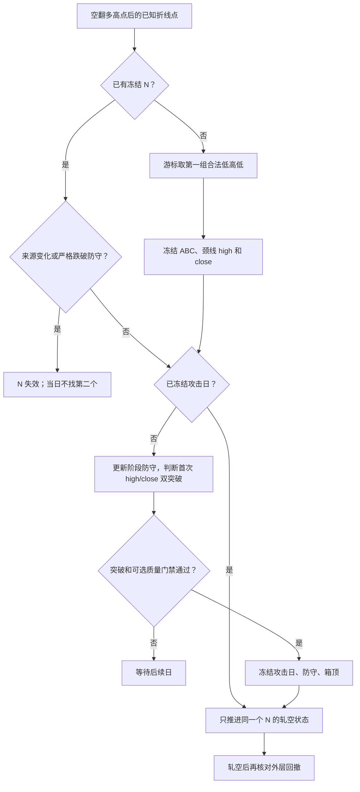

**轧空，single_n::advance_squeeze_indexed：** 最早 t ≥ s+2。只保存攻击 K 线、前两根 K 线、历史最高价和固定状态，不重放 N 历史。

阻力为任一：open < 前收盘；高开收阴；上影长度 ≥ 振幅 × shadow_fraction（默认 0.5）。只在攻击日与次日记录首次阻力，后续每日阻力用于紧邻响应。每日滚动防守为 min(前日 low,前前日 close)，累计记录是否守住、是否每天 close 严格高于前收盘。

基础延续要求当天 close > 此前全部 high。若攻击日或次日有阻力，也允许以下任一延续来源：强阳双突破攻击 K 线；攻击日/次日阻力后的紧邻响应且累计和当天滚动防守守住。使用有阻力路径时，还须收阳、close > 前收盘、close > 攻击日 close。强阳双突破为 high > 攻击日 high、close > 攻击日 close 且满足下文强阳定义；紧邻响应要求上一日就是攻击日或次日的阻力响应，不能用任意晚出现的阻力。

延续成立后，无首次阻力、无未知阻力、连续上涨且始终守住滚动防守，标记 StrongBull；有首次阻力且早于当天，标记 Bull；否则等待。首次 Bull/StrongBull 冻结 squeeze_index，后面未再次出现轧空不撤销该证据，严格跌破 N 防守仍撤销候选。

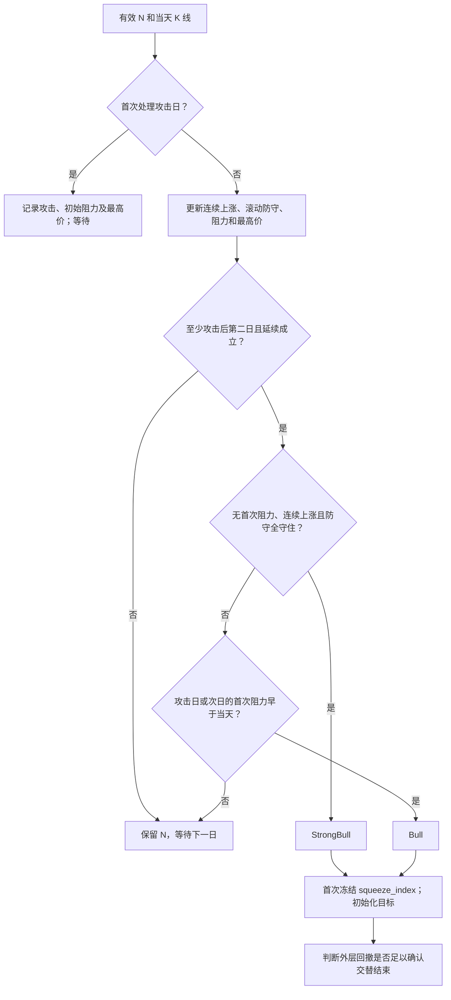

**外层回撤，n_alternation::candidate_proof：** N 轧空成立不直接等于交替结束，还要通过以下条件。

1. `h < nA.index < nC.index <= s <= t`；O/H/K 在 s 已知，ABC 在 t 已知，防守未破；重开须 squeeze_index > after。
2. h+1 至 nC.index 选最低 low 为 L，同低取最早日；`O <= L < H`、l ≤ nA.index，L 至当前未跌破 L；L 至攻击前没有 close > H。O 至 H 上涨阶段未跌破 O。
3. 至少一条外层路径成立：价格路径 `3×(H-L) <= 2×D`；时间路径 `TB > TA 且 2×(H-Q) > D`；或前两条不成立且 `3×(H-L) >= 2×D` 的深回撤路径。深回撤额外要求当天 close > s 至 t-1 的所有 high。
4. 短浅回调定义为 `3×(H-Q) < 2×D 且 2×TB < TA`。此时另需：从 s 至当前出现过 close > H；或当天 close > 攻击日 close、满足轧空阳实体及 squeeze_buy_rejection 门禁。
5. L 须匹配当前已知真实折线低点及价格，不能只取任意 K 线 low。成功返回 L 和单 N 规则码。

短浅回调的轧空阳实体为中阳，或较前日至少倍量、实体涨幅 ≥ 开盘价 2%、实体 ≥ 振幅 45% 的阳线。还须较前日或攻击前一日任一有效正成交量放量，通过阳线突破检查，并满足 open > 前日 high，或 close > 前收盘 × 1.02、实体为正且不小于上影。低开或实体不足的原拒绝，可在满足轧空阳实体且 close > 前日 high 时解除；仍须通过其余量价门禁。这里的当日量价补证仅在短浅回调需要，不是所有 N 资格都强制当天倍量。

首次轧空初始化一饱 `2×箱顶-nA.price`、二吐 `3×箱顶-2×nA.price`；五顶/十满按共享目标状态的回调、推动、叠加逐日形成，未知时 null。目标与资格确认并行，没有先达到一饱/二吐/五顶/十满才开启资格的门禁。

### 通道二：独立量价突破

不要求 N 已形成或轧空。当日满足倍量中阳突破或放量高开强阳之一。

| 形态 | 全部条件 |
| --- | --- |
| 中阳定义 | close > open；实体 ≥ 开盘价 2%；实体 ≥ 振幅 50% |
| 强阳定义 | close > open；实体 ≥ 开盘价 3%；实体 ≥ 振幅 60%；上影 ≤ 振幅 20% |
| 倍量中阳突破 | 前日量 > 0；当日量 ≥ 前日量 × 2；中阳；上影 ≤ 振幅 20%；close > 前日 high |
| 放量高开强阳 | 前日量 > 0；当日量 > 前日量；open > 前收盘；low ≥ open，即有效行情下无下影；强阳 |

读取已知技术折线末跌关键高点 R 和其后低点 L，要求 `h <= r < l < t`、R/L 最晚可知日严格早于 t、`O < L < H`。O 后至当前未破 O，L 后至当前未破 L；当天 close 严格超过 max(R.price,L 至 t-1 的全部 high)。若属于前述短浅回调，还须当天 close > H。成功返回 L、末跌关键位、阻力、量比等内部证据和量价规则码。

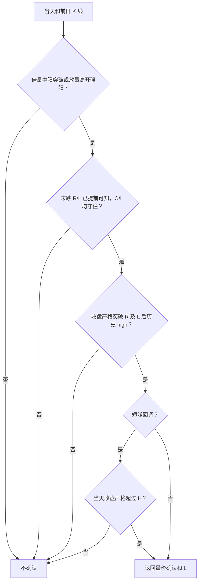

### 通道三：实体缺口、放量、中阳突破

不依赖 N。这里是开盘超过前日实体顶部，不要求当日 low 高于前日 high 的完整价格缺口。

1. 中阳、前日量 > 0、当日量 > 前日量，open > max(前日 open,前日 close)。
2. h+1 至 t-1 选最低 low 为 L，同低取最早日；须匹配已知真实折线低点及价格，且 O < L < H；O 后至当前未破 O。
3. 阻力取 L 至 t-1 最高 high。若有末跌 R/L 上下文，最晚可知日须严格早于 t，用 R.price 提高阻力；没有该上下文也允许，存在但未提前可知则拒绝。
4. 当日 close 严格突破阻力；短浅回调另须 close > H。
5. 返回实体缺口规则，保存依赖下沿 max(前日 open,前日 close)。Active 可被独立确认替代而解除缺口依赖；否则开始日之后 low ≤ 下沿关闭资格。

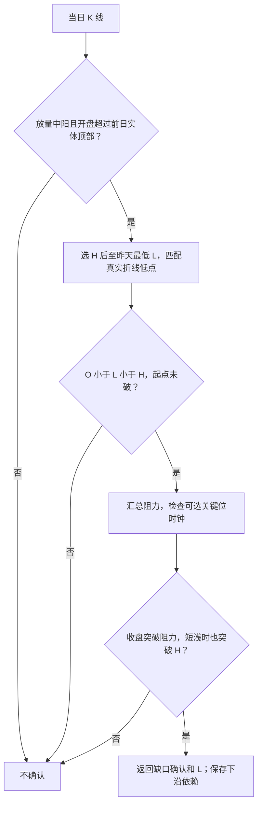

该函数未单列当天 low 必须高于 L 的检查；资格建立后立即执行结束判断，确认成功不代表当天最终必定有效。

### 通道四：普通回撤确认

不要求 N、放量或缺口。读取本级趋势已确认低点，选 H 后、同路径、当天已知的最低 L，同低按点顺序取最早。重开先过滤 knownIndex ≤ after 的旧低点，再选最低点。

- O < L < H；O 后至当前未破 O，L 后至当前未破 L。
- 浅回撤 `3×(H-L) < 2×D`，严格小于 2/3；不强制等下一个本级高点。
- 等于或超过 2/3，必须已有 L 后、同路径、已确认且当天可知的本级高点，其价格严格超过 H。只有当日 K 线 high 超过 H 不足以确认这一分支。
- 两个分支都要补短浅限制：若最低收盘及时间构成短浅回调，须 l+1 至 t 已有 close > H，且 L 至该突破日未破 L。
- 返回 L；浅回撤和确认高点再突破使用各自规则码。

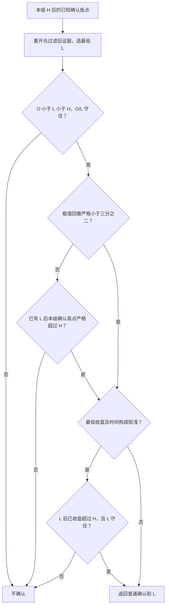

### 返回、重开与当前边界

内部 `AlternationProof { low, rule, evidence }`；前端区间只含 path/startIndex/lowIndex/endIndex/confirmationRule/endReason。lowIndex 是结构参考日，startIndex 才是正式开启日；资格为 `[startIndex,endIndex)`，同日开始结束为零长度，不画有效面积。确认不是买点或成交，当前买卖与账户执行仍停用。

- 本级空头强制结束优先级最高，确认当天也能结束，详见图四补充。
- N 失效直接撤销候选，整个已开启资格是否结束仍由 Active 规则决定，不是 N 一失效就必然关闭资格。
- 重开统一要求 t > after；N 另需新轧空，普通通道另过滤旧低点；独立量价和实体缺口未显式按 after 排除旧回调低点，可能用新确认 K 线复用仍有效旧低点。这是现状，不是额外新增的规则。
- N 外层价格路径允许等于 2/3，普通浅回撤要求严格小于 2/3，边界不能合并。
- 旧 confirm_n_squeeze_alternation 的 120 日枚举、N 盘整缺口、倍量 N 整段回撤、放量反转复活、轧空恢复等仍有源码，但当前数组资格入口未调用旧 N 链，不能列为正在运行的第五、第六通道；独立量价、实体缺口和普通通道仍运行。
- 历史可知时钟、历史来源退出和旧破位重复消费等尚未与 Python 完全对齐，见 [国芳集团资格对照](diagnostics/qualification-python-comparison-2026-10-25.md)。单 N 有意改变候选选择，不承诺区间与旧版相同。

源码：[eligibility.rs](../apps/servers/wavequant-quant-rs/src/analysis/kernel/eligibility.rs)、[single_n.rs](../apps/servers/wavequant-quant-rs/src/analysis/trading/single_n.rs)、[n_alternation.rs](../apps/servers/wavequant-quant-rs/src/analysis/trading/n_alternation.rs)、[量价/缺口 confirmation.rs](../apps/servers/wavequant-quant-rs/src/analysis/trading/confirmation.rs)、[普通 confirmation.rs](../apps/servers/wavequant-quant-rs/src/analysis/kernel/confirmation.rs)、[entries.rs](../apps/servers/wavequant-quant-rs/src/analysis/trading/entries.rs)、[price_action.rs](../apps/servers/wavequant-quant-rs/src/analysis/market_state/price_action.rs)。

## 共享 N 数组与每段有效索引（v29，2026-10-26）

入口为 `kernel/n_memory.rs::calculate_all`。一只股票、一个周期、一个行情版本使用一份 `nRecords` 数组，四级以 `NIndex` 共享同一 N。身份由方向、ABC所在来源路径、行情下标、同根顺序和可知时钟组成；不同路径/版本不得合并。各级仍维护自己的趋势起点与关键位周期，不能因其他级别已经确认 N 就提前取得本级资格。

用途：空翻多之后第一个仍有效的轧空正N，是后续外层 A/B/C 回撤与交替结束判断的参考输入；这里的外层 A/B/C 与组成 N 的三个折线点是不同层次。`eligibility::confirm_bull_alternation_end` 按当前索引取共享N，再由 `n_alternation::confirm_single_n_snapshot` / `candidate_proof` 检查 A 波、B 回撤、轧空及突破条件。只有当日已知且轧空确认完成的N可以进入该通道；N确认不直接等于资格开启。破位后撤销旧引用，新的有效N接替；新趋势读取新趋势的N。倒N对称留作下跌侧参考，当前做多资格不消费倒N。

1. 只有本级首次空翻多/多翻空才启动本趋势N搜索，初始多头/空头及普通同向段不另建N。翻向身份由方向、冻结关键位与起点区分，同一次翻向的攻击端延伸不重启搜索；转入相反方向六态或新的来源路径时解除旧趋势的维护订阅，历史记录只留档。四级共用一个日期外循环；只有各级当前趋势正在使用的N参与日常维护，同一N当天最多推进一次，重复级别读取同一个索引；K线、攻击K线、昨日和前日都按共享行情数组下标读取。ABC来源价格只准备一次，来源引用版本未变时不反复格式化/解析Decimal。
2. 新翻向趋势开始时释放本级上一趋势当前索引，并从已有首次翻向事件中冻结的攻击高点（倒N为攻击低点）之后找N，不用后来的趋势尾点替代该起点；新关键位周期清掉本级旧周期的历史引用。只改变该级引用，不删除仍被其他级别使用的共享N；同一翻向中的普通同向段或攻击极值延伸不重启搜索。
3. “第一个”指该趋势当前第一条仍有效的轧空正N/轧多倒N；每段趋势同时只有一个候选索引，未失效不寻找后面的 N。正 N 严格跌破已冻结轧空低、倒 N 严格突破已冻结轧多高时失效；触及相等仍保留。尚未攻击的候选以回调防守为失效边界。
4. 失效日撤销当前索引，之后从破位时点及之后的新结构继续找首个合格 ABC，不能复活已经失效的旧 N，不在同一天计算第二个候选。替代 N 得到新索引；同段此前已确认的记录保留原索引用于追溯，不覆盖历史。
5. 每次轧空/轧多确认时在 `firstNs` 保存一次趋势起点、确认日和 `nIndex`，同趋势破位后的替代记录可追加，但不会同时生效。`currentN` 的上涨/下跌两个槽至多一个非空；历史记录只留索引，不订阅日常更新。已确认N破位后仍可在本趋势找下一条有效N，这是用户本轮明确的“首个有效N”含义；不会同时维护两条。当前槽也只保存索引，不复制完整 N。`nRecords[index].data` 保存 ABC引用、冻结颈线/防守、攻击/轧空日期和目标，失效日及原因统一保存在该共享行。
6. 正 N/倒 N 及目标仍共用 `single_n` 和有符号投射规则。仅被当前趋势订阅且未失效的共享 N 持续推进；已结束趋势的历史索引本身不触发维护。`nRecords.observedThrough` 表示实际推进到的交易日，不能把停止维护的历史快照当作此后仍有效；相同 N 跨级共享后，不再因某一级先看到或晚看到而维护多份互不一致的状态。
7. 资格通道仍执行既有本级开关、空翻多入口、交替结束确认及结束规则。通知仅在引用新增/撤销或攻击/轧空等资格相关字段变化时产生，保存 `NIndex` 加小型确认快照；目标变动不重发完整 N；正 N 才进入当前做多资格，倒 N 只保存记录。同一本级当前趋势只发布一条当前N；消费者保留ABC坐标顺序以兼容事件回放，不因共享数组的分配顺序改变优先级。N仍需经外层ABC条件确认，不能仅凭轧空开启资格；回放中的引用若有多个仍按ABC的原有坐标顺序仲裁，不按共享数组的分配顺序改变优先级。共享表最终目标/状态不能回填过去：资格回放只读取该日快照，晚绑定的级别从绑定日才可见，不倒填资格日。
8. 资格回放结束后，输出表仅保留当前周期仍引用的候选及历史记录，统一重映射所有 `nIndex`。计算中索引稳定；输出索引绑定本次行情/算法版本，不能跨版本保存。`AnalysisResponse/IndexedAnalysis` 各有一份 `nRecords`，前端精简VO继续只含趋势点和资格区间，不携带内部N表。
9. `analyzer::VERSION = 29` 隔离旧分析缓存，不修改或清空Redis行情缓存。替代规则、跨级共享和持续推进是本轮明确的行为调整，未验证前不宣称资格区间与v28或旧Python相同。

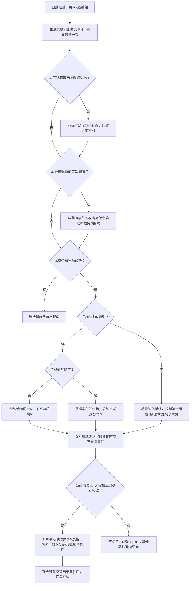

源码映射：`n_memory::{NIndex,NStore,PathState,calculate_all,compact}`、`single_n::{advance_n_indexed,advance_squeeze_indexed}`、`eligibility::calculate`、`n_alternation::confirm_single_n_snapshot`、`analyzer::finish_qualification_arrays`。历史性能证据仍见[v28资格成本](diagnostics/qualification-cost-v28-2026-10-26.md)，不能作为v29速度或结果的证明。随后用户授权的v29三组离线统计见[v29资格成本](diagnostics/qualification-cost-v29-2026-10-26.md)：共享N完整阶段12.4625ms，二级资格消费者3.7727ms；纯趋势到开启资格总计增加16.9439ms，保留N后资格开关增加3.4009ms。这只证明该样本的计时与开关隔离，不证明旧Python等价。未运行浏览器；新增去重、引用隔离、首次翻向锁定及破位替代回归源码待提交时验证。

## 趋势阶段悬停的 N 与目标（v30，2026-10-26）

`n_memory` 在现有单次 N 推进过程中附加只读显示记录：每条共享 N 保存各级使用它的 `[startIndex,endIndex)` 区间；目标价格或已达时钟变化时才保存 `targetHistory`，不按交易日复制完整 N。趋势结束或 N 失效时关闭本级使用区间，历史区间不订阅每日维护。压缩输出时保留历史显示引用需要的共享行，统一重映射 `nIndex`。

前端专用 `state.n` 包含一份 `records` 和四级 `spans`。N 点只传行情 `barIndex/ordinal`；价格从同一 `dataVersion` 的独立行情取 high/low。共享行只投影方向、确认时钟、防守和目标变化快照，不透传内部候选游标、历史证据或完整K线。目标 `prices` 顺序固定为一饱、二吐、五顶、十满；尚未正式产生的目标为null，不在浏览器预估。

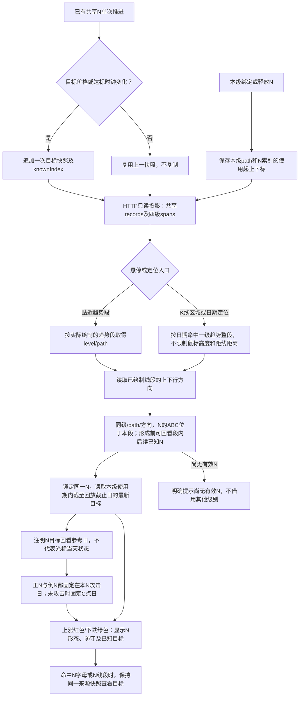

2026-10-26 最新展示入口：普通鼠标位置和日期定位默认读取其所在的一级趋势整段；不要求鼠标靠近N字母、折线或一级趋势线。N的ABC必须属于该一级段，方向/path一致；形成前可回看段内在实际截止日前已经产生的N，提示明确是目标回看。N字母命中保持其来源，明确命中二/三级趋势线时仍切换该级来源；橙色折线不抢走一级整段默认N。一级图层关闭时回退到可见级别。点击保存当前回看，移出恢复已保存来源。不连接新线、不重判六态、不运行N或资格规则、不发送新请求。正N使用低—高—低，倒N使用高—低—高；实际回放截止在轧空/杀多确认前时不显示之后的目标，严格失效后不沿用旧N，后续候选不得跨一级段借用。N形态使用被动图表基元，目标复用现有 `TargetGuideOverlay` 的标签避让和图外提示；不新增series或改变价格范围。

展示方向规则（2026-10-26）：线段已绘制为上涨时，只能展示同级同路径当前有效正N；下跌时只能展示倒N。这里读取现成端点的高低方向，不重新判断趋势六态或改变趋势几何。没有匹配N时明确显示本上涨/下跌段尚无相应N，不显示相反目标；日期超出本级已绘制段也不沿用旧倒N。N形态、目标和防守使用行情语义色：上涨红色、下跌绿色，目标标签统一为“一饱、二吐、五顶、十满”；方向由趋势段标题和涨跌颜色表达，不给目标名称添加上涨/下跌前缀。

本轮方向联调已读取海洋王已有完成结果：二级上涨段不再显示倒N，一级正N为红色，二级倒N为绿色，N字母命中保留同一来源；详情见[显示修复记录](diagnostics/n-trend-hover-display-fix-2026-10-26.md)。

命名统一：正N为“轧空”，防守位为“轧空低”；倒N为“杀多”，防守位为“杀多高”。后端旧市场状态枚举/历史诊断中的“轧多”不在本次改名范围，价格与严格破位规则不变。N字母、端点和N线段有独立命中入口；在N来源上移动时保持已经展示的同一快照及截止日，不因A/B/C早于N确认日而切到其他N。该查看行为不会回填资格或回测状态，也不读取回放截止日之后的数据。

2026-10-26 目标回看时钟：一级段内任意鼠标位置、日期定位及N标识可查看该来源已发布目标；读取边界为实际回放截止、本级使用结束前、N严格失效前及已观察日期中的最早者。锁定同级/path/方向/nIndex，不前端推算目标。提示写“N目标回看截至…；非光标当日状态”。底层`read`仍提供当日因果截面，UI默认整段回看改用`inspectStage`；不会把查看结果写回资格或交易。海洋王N204在7月29日发布一饱/二吐，鼠标在其一级上涨段内可查看；回放截止7月27日则不能显示7月29日目标。

源码映射：`n_memory::{NUsage,NTargetSnapshot,NStore,compact}`、API `application/trend_n.rs`、共享契约 `trend-n.schema.ts`、Web `trend-n-hover.js` / `trend-n-hover-overlay.js` / `charts.js`。本轮是显示记录与展示链路变更，不改变趋势、N或资格判定；VERSION30隔离缺少显示历史的旧分析结果，Redis行情缓存复用。回归源码新增未执行；Rust、contracts和前端的必要启动编译及本地重启已完成。后续用户授权浏览器修复联调：当前海洋王已完成v30结果在普通K线悬停、指定级别命中、历史确认边界、点击保留和图层开关下显示正确，临时诊断钩子清理后正常页面鼠标悬停也可见；未发起新单股计算或性能采样。详见[悬停显示修复记录](diagnostics/n-trend-hover-display-fix-2026-10-26.md)。旧缓存缺少显示历史，当前股票需由v30重新计算后才能显示；v29旧计时不作为v30新增记录成本的证明。

## 图五：买卖判断的入口与资格

以下四张图记录保留在代码中的完整交易逻辑。当前 `STRUCTURE_ONLY = true` 时不会进入这些规则，结构模式返回空交易结果；文档补充不代表已开启交易。

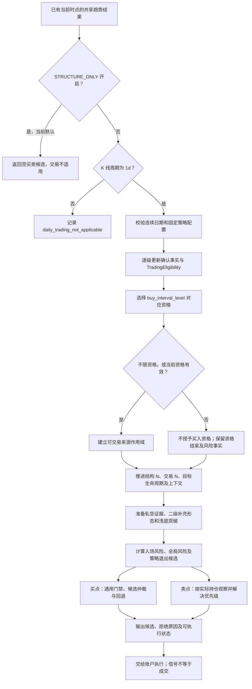

- `buy_interval_level = 0` 表示不限资格，1/2/3 表示选择对应趋势资格；它不是折线层级，也不是 K 线周期。
- 日线资格与趋势六态分别维护。完整调度中，区间开启/结束、确认缺口、来源路径等均保留事件；不能只凭前端显示“多头”授予买入资格。
- 资格外不会因为仍有候选形态而自动获得买入许可。资格结束本身还可能产生退出候选；具体执行时钟与持仓状态仍由后续链处理。
- N 来源及其 `scope`、首次可知时间、失效和退役共同决定候选可用性，不能把图中的“推进 N”理解为扫描整段未来行情。

## 图六：买点生成、筛选与回退顺序

图示以草稿使用的 `lecture()` 配置为主：`whole_flip_wave_v3` 与 `hierarchical_two_buy_points`。兼容策略 `legacy_v2`、`transitioned_squeeze` 等保留独立配置分支，不能将下面的两类买点阈值套用到全部策略。

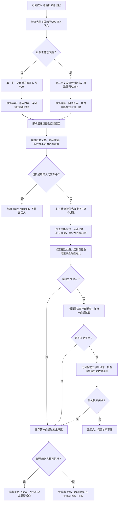

### 两类层级买点的当前边界

共同前提包括来源可知、上下文仍有效、原始起点没有被跌破，以及交替/N 的时间顺序成立。部分同一 N 参与交替确认的情形使用 `joint` 证明，不应误写为所有情况都要求交替严格早于 N。

| 类型 | 当前主要条件 | 基础配置与边界 |
| --- | --- | --- |
| 第一类 `transition_squeeze` | N 攻击前尚未成熟；通常要求二/三级，显式选一级资格时允许一级；交替后新正 N 与轧空证据 | `first_pullback_threshold` 基础为 0.5，开启时回调必须严格大于门槛；可按交替低点或指定区间最低收盘测量；`None` 表示关闭深度过滤 |
| 第二类 `mature_shallow_squeeze` | 已成熟，峰值严格高于翻多高点，峰值、回调低点、N 攻击次序成立 | 回调以峰值至当前最低收盘、相对峰值到原点的幅度计算；基础上限为精确 1/3，基础配置允许等于上限 |

层级选择先比较买点优先级，再比较趋势级别；第二类的 `priority = 2`，第一类为 1。主 N 仲裁还按层级优先级、重新确认/波浪标记、攻击位置的元组倒序检查，并返回首条通过者；不能解释成所有买点同时触发或只挑最新日期。

### 通用门禁与候选过滤

`prepare_trading_day` 在主候选及两条回退链之前依次汇总以下拒绝原因，使用首个命中的原因记录：

1. 放量长上影；整波模式下的放量阴线、反 N 低点及折线门禁限制。
2. 缺口门禁、十满暂停、二吐风险；整波模式的一饱突破观察限制。
3. 当日已有策略退出候选时，阻止同日策略买入。

主候选内还检查有效作用域与轧空轮次、N 失效/退役、二级阻力和反向 N 的恢复证据、原 N 收盘约束、行情状态、量能、止损和结构目标。部分检查受策略配置或特定证明豁免，图中聚合节点不表示这些条件在全部策略下一律同时开启。

基础参数 `minimum_rvol = 1.2`、`minimum_reward_risk = 1.5` 由配置和 profile 决定；整波模式的量能判断并非统一使用 1.2 倍，而有相对前一根或 N 前参考量等专用条件。收盘毛盈亏比预检是可配置条件，实际成交时的价格、费用及净盈亏比不能用它替代。

### 回退候选及执行模型

只有通用门禁未命中且主 N 没有结果，才按以下顺序进入补充形态；每条还需自己的证据、去重、风险和盈亏比条件，并由相关开关控制：

1. 组合 A 回调突破 `combined_a_pullback_breakout`。
2. 二级深回调收复 `secondary_deep_pullback_reclaim`。
3. 二级阻力收复 `secondary_resistance_reclaim`。
4. 待选交替浅底突破 `shallow_base_breakout`。

基础 `TradingDayConfig` 中前三条相关开关为 false，浅底开关为 true；profile 或请求可以改变这些值，不代表当前结构模式在执行它们。

仍无候选，且没有目标/五顶风险时，检查资格内三种独立收盘买点：突破后次日放量跳空守稳、倍量中大阳高位收盘突破、放量高开高走。它们还需有效资格、折线门禁、冻结防守位及一饱/二吐过滤。

主 N 与补充形态候选的基础 `execution_model` 为 `next_open`；独立资格买点为 `same_day_close`。账户装配仍可能按执行参数转换，不得由信号倒推到更早分钟成交。

## 图七：卖点与风险决策的来源

卖点候选来自策略级和实际持仓级两条链，之后才仲裁。不同风险可能要求清仓、比例减仓或累计目标减仓；同名比例也不一定有相同计量语义。

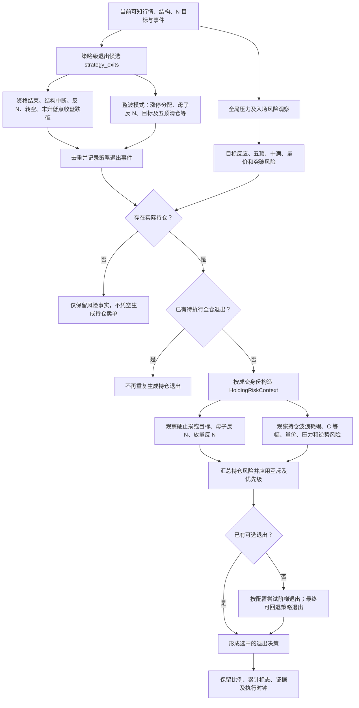

- `strategy_exits` 的整波专用分支包括涨停分配、母子反 N 低点、C 等幅及五顶的特定清仓形态；其他分支包括反 N、新转空事件、资格结束和末升低点收盘跌破。并不是所有目标到达都会立即卖出。
- `entry_risk.rs` 维护目标、五顶、十满相关状态。二吐等目标后的放量阴线、长上影、后续确认可能生成不同的减仓/清仓建议；这些建议还会约束新买入。
- `evaluate_holding_risks` 使用真实入场/信号时间、已减仓标志、持仓关联波浪、压力警告与策略开关；不把入场前全部风险直接视为持仓卖点。
- 某些规则依赖分钟行情；分钟缺失时只有显式开启相应日线回退才使用日线模型，并记录回退证据。不能把日线识别时间当作已经完成的分钟成交。
- `strategy_exits` 内部还对五顶清仓候选排序与去重，随后持仓仲裁有自己的优先级。不能按列表顺序直接执行所有卖点。

## 图八：退出优先级与账户落地

下面是 `risk::resolve_exit_precedence` 的选择顺序。先进行特定风险之间的冲突抑制，再按序取第一个有效候选；不使用“谁的卖出比例最大就选谁”的通用排序。

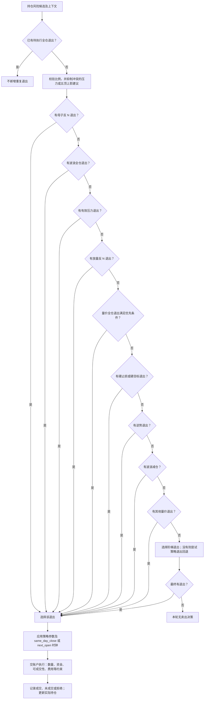

量价全仓优先条件为：没有逆势退出，或者量价原因是 `volume_upper_shadow_next_open_decline_clear`。特定量价事件还会在前置冲突处理中抑制较弱压力/波浪建议；因此图中“压力优先”不表示所有原始压力事件无条件优先。

`system.rs` 先合并分钟决策，随后处理持仓退出；存在进入或退出决策时，不再从当日日线候选重复开仓。仅当没有这些决策时，日线候选还需 `fully_executable`，持仓加仓需允许 `allow_add_on`，也可能只抬高止损。选中的日线买点或卖点仍要经过执行模型与账户处理，不能把 `long_signal`、`exit_signal` 或 `RuleDecision` 直接标为成交。

### 本节覆盖边界

图五至图八是当前完整交易实现的入口、分支和仲裁总览，不逐条复制所有烛形公式、分钟撮合及持仓比例公式。叶子条件以对应源码为准；新增、删除或改动会改变买卖结果的叶子规则时，须同步相关图或在对应说明中明确记录。当前交易停用，本次未执行回测、交易链或 Mermaid 渲染验收。

## 后续同步维护要求

1. 改动上表涉及的实际行为、启用开关、默认选项、循环顺序、偏移恢复条件、阈值或输入输出语义时，必须在同一变更中更新对应 Mermaid、说明及最近源码核对日期；图示不能仅写计划行为。
2. 启用或停用二级、三级、交易，或改变逐日与数组快速路径时，必须更新图一、当前范围和前端 `enabled` 的说明。
3. 调整普通/特殊翻转、等级分支、确认来源、连续性或回撤边界时，同步核对图二、图四。修正源码已有差异后删除过时现状说明，不能只更新日期。
4. 买点资格、两类入场阈值、通用门禁、候选排序/回退、卖点风险及退出优先级、减仓语义或执行时钟变更时，必须同步图五至图八、空多交替结束确认通道详解及对应源码映射；不能只维护趋势图。
5. 纯命名或文件迁移而未改变行为时更新源码映射；不为凑改动重画无变化的流程。
6. 按仓库规定的开发/提交验证节奏执行必要检查；未运行的渲染或行为验证如实记录为待验证，不因维护文档自行启动测试、浏览器或构建。
7. 图示依靠人工随代码维护，不是从 AST 自动生成，也没有新增自动一致性门禁。评审相关逻辑变更时必须核对本文是否同步。

## 维护记录

| 日期 | 变更 | 证据边界 |
| --- | --- | --- |
| 2026-10-24 | 首次整理四张 Mermaid、源码映射、当前停用范围及同步维护要求 | 源码阅读；未运行算法、渲染、测试或构建 |
| 2026-10-25 | 资格按等待空翻多、开始确认、有效期间结束三阶段推进；本级空头强制结束 | 源码对照旧 Python；回归源码未执行，当前区间待验证 |
| 2026-10-25 | 修复失败翻向反破冻结极值时遗漏反向翻转事件，恢复资格确认入口 | 当次授权海洋王真实结果：12条记录、7条同日关闭、5段有效区间；Chrome已观察红区及蓝边界；Worker摘要拒绝另记，非全量等价验证 |
| 2026-10-25 | 接入数组路径资格确认/同日结束、独立级别开关及索引区间展示图 | 必要启动编译和重启；算法与浏览器回归待验证 |
| 2026-10-24 | 补充交易资格、买点筛选与回退、卖点来源、退出优先级四张图及账户边界 | 阅读Rust源码；当前交易停用，未运行算法或渲染验证 |
| 2026-10-25 | 整理当前四类交替结束确认、单N与轧空细节、精确阈值和六张细分Mermaid | 源码核对；提交阶段Rust库36项通过，Mermaid未渲染，Python差异仍保留 |

| 2026-10-25 | v27 四级关键位周期、正 N 轧空/倒 N 轧多首记录、失效保留及资格只读复用 | 本轮回归与结果对照待提交时验证；默认启动另记 |

项目统计技能：[quant-performance-compare](../.agents/skills/quant-performance-compare/SKILL.md)，支持同输入前后耗时、数据量、内存、缓存元数据与不重算股票的报告整理。

## 各段六态与增量复用（v28，2026-10-26）

四级共用 `kernel::TrendState` 枚举：空翻多、空多交替、多头、多翻空、多空交替、空头。不再新增另一套含义相同的枚举；证据不足使用 `None/null`，不是第七态，也不按几何升降强行指定多头/空头。

- `structure::SixStateMachine::advance` 是六态规则的唯一实现，保留冻结关键位、攻击及回撤背景。批量入口只逐点调用它，阈值及翻向规则不变。各级由本级来源计算自己的状态，不能把下一级六态直接当作上一级六态。
- `SixStateCursor` 在已闭合点后保存状态检查点；`publish` 标记最早变化的坐标，`ObservationCursor::sync` 只撤回和推进该坐标之后的后缀。来源偏移恢复同时恢复六态检查点，不从空背景判断任意截断片段。
- 发展尾端可能替换最后一个同类闭合极值，使用该端之前的检查点试算一个端点。临时端点不写入正式几何或提供给上一级。历史观察直接保存计算出的六态枚举与真实可知时钟；事件按稳定身份去重，不反复扫描完整历史事件。
- `RefFrame/KernelFrame.segment_states` 与本级正式 `points` 对齐，第 i 项是以第 i 个点结束的入段状态；首端、证据不足及缺少共同状态背景的连续性桥接为 null。发展尾端另存 `candidate_trend_state/candidate_state_known`。N 和资格直接消费已有观察及上下文，不重跑六态。
- 内部 `IndexedLevel.trendStates/trendStateKnownIndices` 与点表对齐。前端四级点 DTO 新增 `trendState`；它描述入段，`trendStateKnownIndex` 省略时等于 `knownIndex`，只在动态端状态观察更晚时额外返回。历史消费者只可在该时钟后使用此枚举，不能按最终标签回填早日；`state.trendState` 仍是各级当前摘要。
- 算法版本 28 隔离旧分析结果；行情版本及 Redis 行情缓存不变。新增六态数据会增加结果字节，不能只宣称性能改善而忽略传输成本。性能及结果对照见本轮诊断报告，未经测量不填写提升比例。

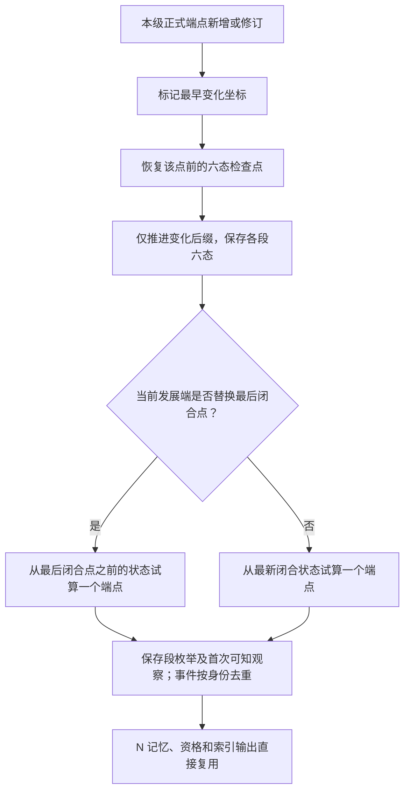

源码映射：`kernel.rs::TrendState`、`kernel/structure.rs::{SixStateMachine,SixStateCursor}`、`kernel/observations.rs::ObservationCursor`、`kernel/waves.rs::publish/path_trend`、`kernel/drawing.rs::snapshot_indices`、`analysis/indexed.rs`、`application/trend_state.rs`、`@repo/contracts` 的 `TrendStateSchema` 及前端 `public/trend-state.js`。历史 Python 资格差异仍单独留项，本次优化不修订结束门槛。

本轮同输入结果与计时见 [四级段六态复用 v28 对照](diagnostics/segment-six-state-performance-2026-10-26.md)：分析83.1222→59.2583ms，一级27.8700→2.4855ms，原有四级结构、N记忆及资格区间一致；前端压缩节点表估算增加1203B。只代表国芳集团同输入离线计算；浏览器与完整Python等价未验证。

2026-10-26 目标展示命名：图中标签与悬停提示统一使用“一饱、二吐、五顶、十满”，去掉目标名称的上涨/下跌前缀；方向标题与涨跌颜色保留，内部one_p/two_t/five_top/ten_full、价格、快照和达标规则不变。

2026-10-26 固定N目标位置：正N与倒N共用一级整段回看入口；鼠标在本段移动不改变目标横坐标。`trendNTargetGuides`以该N攻击日为固定锚点，攻击尚未出现时取C点日期，纵坐标仍为后端目标价格，上涨/下跌目标自然位于形态上方/下方或对应价格位置。图外目标仍使用既有边缘提示。光标K线与提示日期继续更新，目标不会跟着横向移动；缓存键使用N索引、目标快照和固定锚点，不按光标横坐标重建目标。
