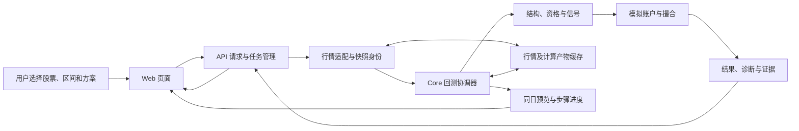
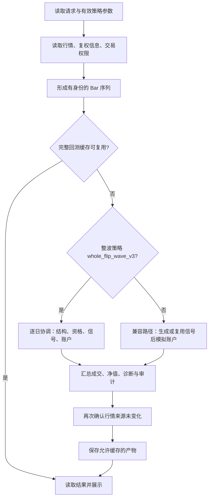
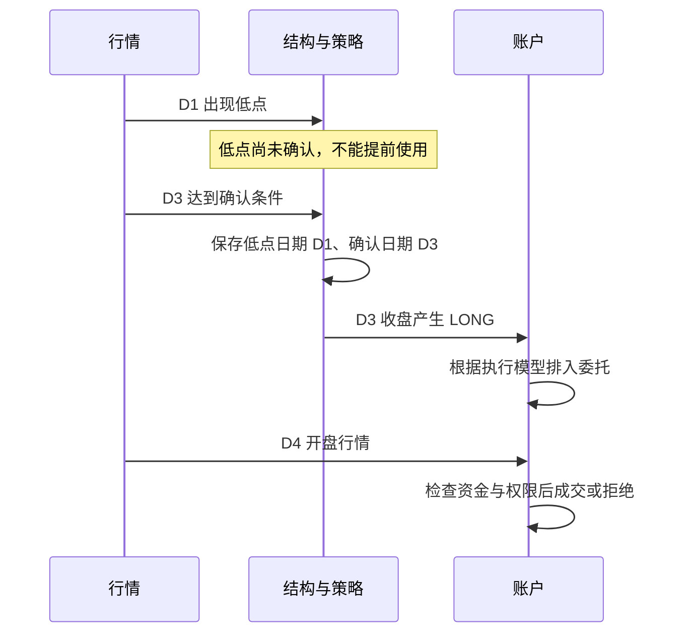
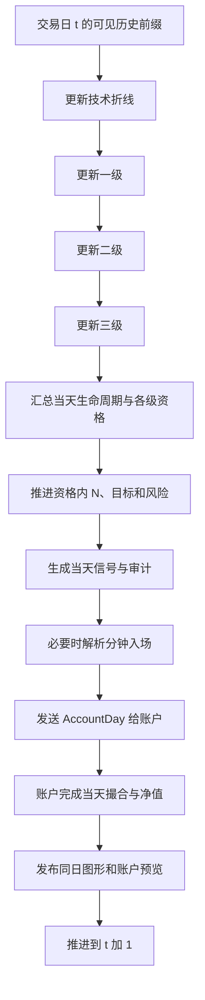
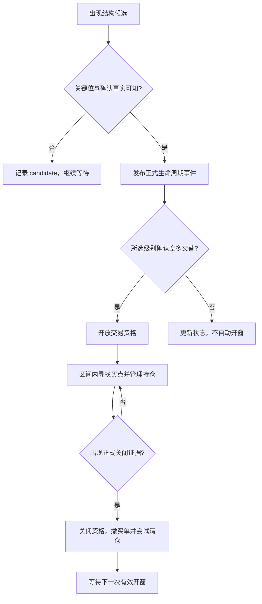
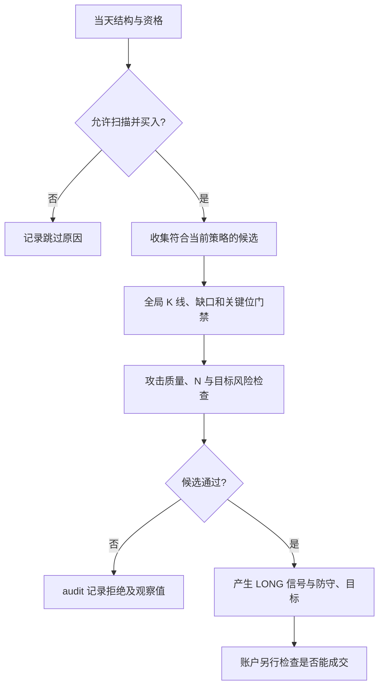
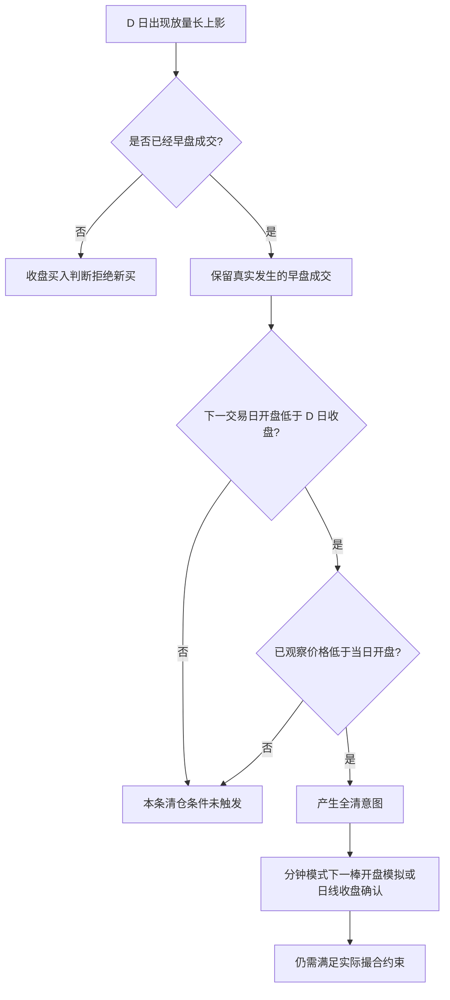
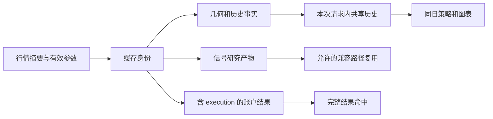

# WaveQuant 回测全流程与数据产出指南

> 受众：第一次接触项目的开发、测试、产品和策略研究同学。  
> Owner：WaveQuant Core 维护者；接口与页面部分由对应 workspace 维护者协同更新。  
> 编写日期：2026-10-19。范围：`feat-三级趋势统一` 当前工作区源码，包括尚未提交的长上影规则。  
> 依据：静态代码阅读；本次没有运行回测、测试或 Mermaid 渲染。示例均为教学数据，不是实股计算结果。运行验证与既有失败以根 `feature_list.json`、各 workspace `progress.md` 为准。

## 1. 先用一句话理解回测

回测是按历史时间顺序，让策略每天只使用当时可知的信息提出交易意图，再由模拟账户按照资金、费用和可成交约束执行，最终统计账户变化。

项目里必须区分五件事：

| 概念 | 回答的问题 | 不代表什么 |
| --- | --- | --- |
| 行情 | 当天价格和成交量是多少？ | 不等于结构确认 |
| 趋势结构 | 哪些高低点组成了哪一级趋势？ | 不等于已经获得买入资格 |
| 交易资格 | 当前允许寻找买点吗？ | 不等于必须买入 |
| 信号 | 策略想买还是想卖，依据是什么？ | 不等于成交 |
| 成交 | 模拟账户实际买卖了多少、用什么价格？ | 不等于真实券商成交 |

阅读顺序建议：先看第 2～4 节建立整体认识，再看第 5～10 节理解规则，最后用第 11～15 节查结果和定位问题。

## 2. 系统由哪些部分组成



| 层 | 目录 | 主要职责 |
| --- | --- | --- |
| 页面 | `apps/webs/wavequant-web` | 选择参数、显示 K 线/趋势/买卖标记、轮询任务与预览 |
| 服务 | `apps/servers/wavequant-api` | HTTP 参数边界、任务去重与容量、调用 Core、返回结果 |
| 核心 | `packages/wavequant-core` | 行情转换、趋势与策略、模拟成交、收益统计 |
| 契约 | `packages/contracts` | 页面与服务共享的数据结构，例如 24 步进度 Schema |

API 的 `BacktestJobs` 管理请求 ID、运行中任务、进度和短期结果。相同请求 ID 重试可以取回原任务；参数不同却复用同一个 ID 会发生冲突。同股票已有任务、任务容量不足也有明确处理。任务恢复和业务产物缓存是两个不同机制：新请求仍可能命中有效的磁盘产物。

## 3. 一次回测从开始到结束



主入口 `single_stock_result` 要求非空、单股票历史。整波策略在没有已完成账户结果时转入 `streaming_stock_result`；后者在结束后再调用前者做结果包装，不重新模拟账户。

`run_portfolio` 本身支持多股票共享资金；单股票页面使用独立账户。多只股票的独立账户收益不能简单相加当成一个共享资金组合的收益。

### 3.1 数据接力表

| 步骤 | 输入 | 核心处理 | 输出结果/数据产出 | 下一位消费者 |
| --- | --- | --- | --- | --- |
| 1 请求归一化 | 股票、起止日期、策略和执行设置 | 校验参数、补齐有效配置、确定任务身份 | 有效 `strategy`、`execution`、请求身份 | 任务与行情服务 |
| 2 行情准备 | 日线、除权资料、数据源元信息 | 截止日期过滤、复权与权限转换 | `list[Bar]`、来源摘要、实际区间 | 结构和账户 |
| 3 技术折线 | 当前日及历史价格关系 | 确认 H/L 点、维护发展尾部与中断 | `LinePoint`、`ReversalPoint`、当天图形帧 | 一级趋势、N 结构 |
| 4 一级趋势 | 技术折线高低点 | 共用趋势函数判断结构 | 一级正式/发展趋势与候选证据 | 二级趋势、一级生命周期 |
| 5 二级趋势 | 一级趋势结果 | 同一函数、直接下级来源 | 二级正式/发展趋势与候选证据 | 三级趋势、二级生命周期 |
| 6 三级趋势 | 二级趋势结果 | 同一函数、直接下级来源 | 三级正式/发展趋势与候选证据 | 三级生命周期、图表 |
| 7 六态和资格 | 本级结构、关键位、确认事实 | 生成状态事件、开放或关闭区间 | `lifecycle_events`、`TradingInterval`、资格布尔值 | 买点与账户边界 |
| 8 N 和测幅 | 已知 A/B/C、攻击与确认 | 确认完成/失效、冻结锚点并推进目标 | `NObservation`、`NTargets`、投射事件 | 买点、目标阻力、退出 |
| 9 策略决策 | 资格、结构、量价、目标与风险 | 筛候选、检查门禁、记录原因 | `Signal`、`audit`、`counts` | 分钟执行解析和账户 |
| 10 分钟解析 | 合法候选、可用分钟行情 | 使用已完成分钟棒构造当时证据 | `entry_executions`、部分日线、降级记录 | 账户撮合 |
| 11 模拟账户 | 当天信号、持仓、资金、风险 | 卖出/买入排序、费用、T+1、流动性 | `orders`、持仓、`Trade`、日净值 | 指标和结果包装 |
| 12 汇总展示 | 全部账本与审计 | 统计指标、整理成交证据与诊断 | `metrics/equity/orders/trades/signals/audit/backtest` | API、图表、导出 |

“没有输出行”本身可能是正常结果：没有确认拐点、资格未开放、候选被拒绝、没有成交都可能产生空集合。应同时阅读阶段状态和拒绝原因，不能把空集合直接当作程序故障。

## 4. 最重要的时间规则

### 4.1 三种日期不能混用

| 时间 | 例子 | 用途 |
| --- | --- | --- |
| 价格发生日 | D1 出现低点 | 在图上定位低点 |
| 确认可知日 | D3 才满足反转确认条件 | 从这一天起允许策略消费该低点 |
| 决策/成交时点 | D3 收盘决策、D4 开盘成交 | 决定现金与持仓何时改变 |



`PivotRef.index`/`LinePoint.index` 定位价格；`confirmed_index` 表示确认。生命周期还会记录 `bar_index`、`available_index`、`flip_known_index` 等知识时钟。字段并非每类事件都齐全，必须按事件类型读取。

### 4.2 每天的同日协调



`MarketDay` 包含当天图形帧、三级结果、生命周期事件和三个资格值。`AccountDay` 包含当天信号、N 事实、波段事件、层级视图、分钟入场结果、资格状态与关闭标志。协调器要求账户发布日与市场帧日期相同。

这是架构上的因果边界，不表示所有历史实现都已经获得“无未来数据”的验证证明。例如当前账户保留了 `full_session_candle_filter` 标记的全天阴线过滤；解读早盘结果时需要审查这类模型假设。新长上影禁买规则另行区分收盘判断与已有早盘成交，不能用收盘形态倒填一个早盘卖点。

## 5. 原始行情怎样变成可计算数据

`Bar` 是策略和账户共用的基本记录：

| 字段 | 含义 |
| --- | --- |
| `timestamp/symbol` | 时间与股票代码 |
| `open/high/low/close` | 当前价格基准下的开高低收 |
| `volume` | 原始成交股数口径 |
| `adjustment_factor` | 等价复权价 / 原始价 |
| `buyable/sellable` | 对应执行入口使用的交易许可 |
| `close_buyable/close_sellable` | 独立的收盘许可，部分自定义输入可能为空 |
| `nonflat_close_*` | 非一字板收盘模拟的显式许可事实 |
| `raw_is_st/raw_trading_active` | 分钟权限判断可用的原始状态事实 |

通达信适配器读取本地日线与除权资料，按请求截止日截取；实际起点不早于本地第 21 个交易日，避免把普通股票规则误用于上市初期。这个限制是该适配路径的行为，不应推广成所有数据源统一规则。

价格转换关系：

```text
等价价格 = 原始价格 × 当日 adjustment_factor
模拟原始成交价 = 等价成交价 ÷ 当日 adjustment_factor
实际股数 = 引擎等价份额 × 当日 adjustment_factor
```

因此，报价面板中的原始收盘不能直接与等价复权高低点比较。账户按等价份额记账，最小交易手数和流动性约束会换回实际股数口径。

数据来源记录包括价格基准、引擎身份、日线/除权/分钟摘要及实际区间。通达信当前模型使用普通非 ST 股票研究假设与等价份额近似，不是完整分红税、配股缴款现金账本；这些边界会进入结果的 `limitations`。

## 6. 技术折线和三级趋势怎样形成

### 6.1 技术折线

技术折线把行情转换为交替的高低点。`LinePoint` 保存 `index/ordinal/kind/price`；其中 `ordinal` 区分同一根棒内的结构顺序。`ReversalPoint` 再附加确认日和来源。

包含线、母子线和同棒高低点存在路径歧义。系统通过既定讲义规则与路径证据处理，不能简单按红绿 K 线猜测真实盘中先后。正式确认点和发展尾部的用途不同，图上的尾部不能自动成为已确认交易锚点。

### 6.2 三级使用同一核心函数


`prepare_trend_lines` 负责按来源路径准备结构，各路径调用共用趋势判定。一级取折线，二级取一级，三级取二级；不允许三级越过二级直接使用日线拼一套独立趋势。

主要产物包括：

| 数据 | 用途 |
| --- | --- |
| `source_strokes` | 说明本级使用了哪些直接来源 |
| `strokes` | 已形成的本级结构 |
| `developing_strokes` | 仍在发展的尾段 |
| 候选与证明记录 | 说明为什么可以升级、翻转或继续等待 |
| 按日期保存的变化记录 | 回放某天当时已知的结构，而不是裁剪最终图 |

关键判定包括来源高低点关系、已知末跌高/末升低的严格突破、普通或特殊反转证明、路径连续性。首次整波还需要有效四点与内部下级结构，保存独立起点/极值；不应把未满足升级条件的局部片段单独画成高一级趋势。

`attach_trend_permissions` 在已准备几何上附加许可与证据，不为图表重新画另一套结构。图表、策略和历史回放消费同一时点结果。

## 7. 六态和交易资格

六态名称用于解释趋势推进：空翻多、空多交替、转多确认、多翻空、多空交替、转空确认。真实执行还包括候选、失效与撤销事件，不能把它理解成每个周期一定走完六格的机械循环。



`TradingEligibility` 按本级、`source_path` 维护窗口。`TradingInterval` 保存起止日、开窗翻转点、交替低点、结束原因、被破关键位及缺口确认信息。

开窗消费正式的空多交替事件，要求翻转已确认、相关索引按因果顺序可知。单纯出现一条上升线、突破某个局部高点或形成候选，不足以直接开窗。

关闭来源包括：

| 关闭来源 | 典型含义 |
| --- | --- |
| 多空交替完成 | 本级已完成相反方向交替 |
| 本级末升低被破或转空确认 | 本级结构不再支持原资格 |
| 直接来源空头确认 | 下一级的正式破位证明沿直接来源传递 |
| 反转低点失守 | 已知有效防守低点被严格跌破 |
| 确认缺口回补 | 原资格依赖的缺口失效，且没有被独立确认替代 |
| 来源修订或路径结束 | 原确认依赖不再有效 |

`buy_interval_level` 选择资格级别，当前类默认值为 2，也可选择 1 或 3。不是任意一级允许就统一放行。买入区间不含结束日；风险扫描可包含结束日，执行层在该日专门处理撤单和退出。

**区间外账户的当前行为：**整波流式路径在关闭日尝试收盘清仓。若 T+1、停牌或容量限制导致未能卖完，剩余持仓与待退出状态会保留；空档期间不继续撮合或推进风险，沿用账户快照。因而这段净值不能误读为剩余仓位每日重新盯市后的市场价值。

## 8. N 结构、A/B/C 和目标位

标准 N 使用三个已知锚点：A 为起点、B 为颈线、C 为回撤点。除了价格位置，每个锚点还带确认日期。N 的状态包括等待锚点、形成中、起点失效、回撤延伸需换锚、完成。

注意代码中两个 A/B/C 语境：`NSetup` 的起点/颈线/回撤，以及后续波段投射的 A 波/B 回撤/C 推进。阅读事件时要先确认所属模块，不能把字段名称相近当成同一根锚点。

`project_n_targets` 的公式：

```text
等浪 equal_wave = C + B - A
一倍箱体 one_p = 2X - A
二 T two_t = 3X - 2A
X 是独立的箱体锚点，不能默认替换成 B。
```

教学例：A=10、B=12、C=11、X=12.2，则等浪=13、one_p=14.4、two_t=16.6。这只说明公式，不代表存在合法 N、买点或可成交订单。

目标不是预言：必须先确认 N 完成并冻结锚点，再逐日判断目标到达、支撑破坏、回撤及再攻击。`wave_projection` 在满足前提后维护五顶、十足等投射阶段；不是每个 N 自动拥有这些远端目标。旧目标可用当日极值判断是否到达，新产生的同日目标有更严格观察口径，避免先看全天高点再倒算早先已达标。

产物：`NObservation` 保存状态、完成证明和防守破位；`NTargets` 保存测幅；`WaveProjectionEvent` 保存攻击来源、状态、目标、已到阶段、A 高点/B 低点及防守线。买点选择与卖出观察器共同使用这些事实。

## 9. 从资格到买卖信号

资格是第一道门。策略接着检查候选通道、趋势许可、N 完成或攻击证据、量价质量、目标阻力与防守位置，最后决定是否生成 `LONG` 或 `EXIT`。



当前分支的量价规则例子：

- 放量阴线：阴线成交量严格大于前一天或前一根阴线的有效正成交量；某些形态有更具体的拒绝原因。
- 放量长上影：量严格大于前一天，上影至少占全天振幅一半且不短于实体，不限定阴阳线。此规则是本分支待验证修改。
- 突破末跌高：相关突破规则使用严格高于，触及相等不能冒充突破；具体观察口径由对应规则决定。
- 母子线、跳空大阴线、目标区阻力等观察器会产生退出或减仓事实，不能仅凭“到了某个目标价”推断已成交。

`Signal` 关键字段：`timestamp/symbol/bar_index/side`、参考价 `reference_price`、失效价 `invalidation_price`、原因 `reason`、触发时间 `trigger_timestamp`、目标 `target_price`、最低盈亏比等。

`audit` 是解释链：候选、拒绝、状态、目标和信号证据。`counts` 是聚合计数。信号、审计事件、订单和交易数量没有一对一关系。

## 10. 模拟账户如何成交

### 10.1 三类执行时间模型

| 模型 | 决策来源 | 模拟价格 | 注意事项 |
| --- | --- | --- | --- |
| 次日开盘 | 前一交易日已知信号/待执行退出 | 后续交易日开盘 | 区间末尾可能没有下一根，留为未执行 |
| `same_day_close` | 当天完整日线或明确收盘规则 | 当日收盘 | 是显式模型假设，不是收盘前精确下单证明 |
| `intraday_5m_next_open` | 已完成五分钟线 | 下一根五分钟线开盘 | 不把尚未完成的分钟棒高低点用于决策 |

`entry_at_close`、`consolidation_entry_intraday`、`staged_exit_intraday` 等控制适用模式。类默认值与页面方案覆盖可能不同，应以返回的有效 `execution` 为准。

分钟源缺失或校验不完整时，默认不会悄悄补出分钟路径。是否允许日线降级由 `missing_minute_daily_fallback` 决定；允许时记录 `minute_fallbacks`，否则按相应错误结束。部分日线以已观察分钟累计高、低、收盘和成交量构建。

### 10.2 每日账户操作顺序

概念顺序如下；各退出类型还会根据证据时间和优先级细化：

1. 接收 `AccountDay`，先处理资格关闭或区间外快照分支。
2. 对有效交易日，处理可在开盘执行的历史退出意图，再处理待买入。
3. 合并当天分钟买卖动作，按时间排序；同一时间卖出动作在买入动作前。
4. 更新持仓风险，处理当天可确认的全清、减仓、止损等证据。
5. 执行明确的收盘退出；消费当天策略信号并维护待执行单。
6. 启用收盘买入时，在收盘退出之后撮合买入，不用当天更早最低价止损刚建立的收盘仓位。
7. 更新现金、市值、净值与当天预览。

全清意图不等于保证卖光。撮合仍检查交易许可、T+1、流动性容量、数量和费用；无法执行会记录 `deferred` 等状态。买入可能为 `cancelled`，成交记录为 `filled`。

### 10.3 买多少

账户先计算多个上限，再取最小值，并按交易手数取整：

```text
风险预算 = 当前净值 × risk_fraction - 已有仓位占用风险
风险份额上限 = 剩余风险预算 ÷ (含滑点买价 - 有效止损价)
仓位份额上限 = 剩余允许仓位金额 ÷ 买价
现金份额上限 = 可用现金 ÷ 买价
流动性份额上限 = 历史成交量容量 - 当天已使用容量
候选份额 = min(以上上限)
最终数量 = 按实际手数折算取整，并再次检查费用后的现金和风险
```

订单证据会保存限制因素 `limiting_constraint`、风险预算、现金、目标、防守价与盈亏比。流动性容量主要使用此前历史成交量，而不是把当前全天成交量全部当作开盘可成交容量。

### 10.4 费用、滑点和复权

`transaction_fee` 按配置计算最低佣金、费率以及启用时的 A 股税费；模型中税率随历史日期分段。滑点以基点计入成交价格。这里记录的是代码中的历史模拟假设，不是对当前券商费率的承诺。

退出会更新已实现盈亏、分摊费用与剩余持仓。部分卖出先留在订单和持仓累计信息里，最终仓位关闭时产生对应 `Trade`。期末仍未平仓的仓位保留在 `open_positions`，不会为了美化统计而强行按最后一日收盘卖出。

### 10.5 长上影规则的完整例子

以下是用户确认口径在当前分支的设计，尚待提交验证：



本条只观察下一交易日，不能延伸成任意未来某天低开都清仓。相等开盘不算低开，最低价只等于开盘不算走低。

### 10.6 资格内放量高开高走当日买入

当前分支新增待验证通道：开盘严格高于前收，但未严格越过前高时，不再仅因缺少跳空而遗漏当日买点。要求所选级别资格有效、成交量严格大于上一日正成交量、全天最低不低于开盘，且复用强阳标准（实体至少开盘 3%、至少振幅 60%、上影不超过振幅 20%）。

此类信号 `qualified_volume_high_open_rising_close` 只在收盘确认，账户即使常规配置为次开盘，也对这一类当日收盘撮合。原有严格跳空分钟通道保持；收盘许可、目标空间、资金、费用、同日退出优先与加仓开关仍由账户约束。达到条件不保证涨停价可以成交。

## 11. 24 个计算步骤分别产出什么

这些编号来自 `calculation_steps.py`，是稳定的业务记录槽位。`calculation_plan.py` 固定同日传播依赖；旧顺序偏好只作为审计信息保留，不能把各级历史拆开变成独立全量串行任务。

| 编号 | 名称 | 主要输入 | 记录产物 |
| --- | --- | --- | --- |
| 1 | 技术折线 | 行情前缀 | 折线与当天图形事实 |
| 2 | N 字目标位 | 已知折线锚点、资格与攻击 | N 测幅和目标推进记录 |
| 3 | 一级趋势线 | 技术折线 | 一级结构 |
| 4 | 一级空翻多 | 一级状态与关键位 | 对应状态、候选或失效证据 |
| 5 | 一级空多交替 | 一级交替及确认 | 对应事件与知识时钟 |
| 6 | 一级转多确认 | 一级确认事实 | 对应确认记录 |
| 7 | 一级多翻空 | 一级状态与关键位 | 对应状态、候选或失效证据 |
| 8 | 一级多空交替 | 一级反向交替 | 对应事件与知识时钟 |
| 9 | 一级转空确认 | 一级空头确认事实 | 对应确认记录 |
| 10 | 二级趋势线 | 一级结构 | 二级结构 |
| 11 | 二级空翻多 | 二级状态与关键位 | 对应状态记录 |
| 12 | 二级空多交替 | 二级交替及确认 | 对应事件与知识时钟 |
| 13 | 二级转多确认 | 二级确认事实 | 对应确认记录 |
| 14 | 二级多翻空 | 二级状态与关键位 | 对应状态记录 |
| 15 | 二级多空交替 | 二级反向交替 | 对应事件与知识时钟 |
| 16 | 二级转空确认 | 二级空头确认事实 | 对应确认记录 |
| 17 | 三级趋势线 | 二级结构 | 三级结构 |
| 18 | 三级空翻多 | 三级状态与关键位 | 对应状态记录 |
| 19 | 三级空多交替 | 三级交替及确认 | 对应事件与知识时钟 |
| 20 | 三级转多确认 | 三级确认事实 | 对应确认记录 |
| 21 | 三级多翻空 | 三级状态与关键位 | 对应状态记录 |
| 22 | 三级多空交替 | 三级反向交替 | 对应事件与知识时钟 |
| 23 | 三级转空确认 | 三级空头确认事实 | 对应确认记录 |
| 24 | 多级协同、B/S 与回测 | 当天全部事实与账户状态 | 区间、当天信号/订单/净值、最终包装结果 |

状态记录会按级别和状态进入对应槽位；某些失效事件会关联多个状态槽位。因此 `rows` 是该槽的记录数，不是交易次数，也不能把各槽行数相加作为“独立事件总数”。

进度字段：

| 字段 | 解释 |
| --- | --- |
| `status` | `pending/running/completed/failed/not_recorded`，表示步骤记录状态 |
| `cache` | `none/buffering/stored/available/partial/failed`，表示缓存状态 |
| `rows` | 已记录的行数 |
| `elapsed_seconds` | 阶段耗时信息 |
| `encoding_seconds/write_seconds` | 编码与写入成本 |
| `encoded_bytes/reused_bytes` | 新编码与复用数据量 |
| `error/cache_error` | 计算或缓存层错误 |

`completed` 不代表产生买点；`stored` 不代表发生交易；`not_recorded` 不等同于计算失败。进度百分比用于显示进展，不能推导剩余运行时间。

## 12. 最终结果字典怎样读

| 路径 | 内容 | 常见问题 |
| --- | --- | --- |
| `signals` | LONG/EXIT、参考价、防守和目标 | 策略是否发出意图？ |
| `audit` | 状态、候选、拒绝和触发证据 | 为什么允许或拒绝？ |
| `orders` | filled/cancelled/deferred、数量价格费用与时钟 | 意图实际执行了吗？ |
| `trades` | 已关闭仓位的进出场、盈亏和费用 | 哪些交易已经结束？ |
| `equity` | timestamp、cash、market_value、equity、exposure、positions | 账户每天怎样变化？ |
| `metrics` | 收益、回撤、波动、交易统计 | 整体结果如何？ |
| `backtest.strategy/execution` | 有效策略与执行配置 | 此次到底用了什么规则？ |
| `backtest.counts/screening/diagnostics` | 筛选与执行诊断 | 候选在哪层被阻止？ |
| `backtest.open_positions` | 未平仓仓位、累计与浮动盈亏、待退出原因 | 期末风险是否还留着？ |
| `backtest.minute_fallbacks` | 分钟覆盖不足及日线替代证据 | 哪些成交不是分钟模型？ |
| `backtest.holding_drawdowns` | 持仓过程回撤 | 持仓期间经历了多大不利变化？ |
| 外层数据源元信息 | run_id、来源摘要、价格基准、limitations | 是否可以解释和复现本次输入？ |

### 12.1 核心指标公式

设初始资金为 C，最终权益为 E，统计日收益为 r，交易日数量为 n：

```text
总收益 total_return = E / C - 1
年化收益 annualized_return = (E / C)^(252/n) - 1
日净值 = 现金 + 持仓按当前账户 mark 计价的市值
账户最大回撤 = min(当日净值 / 此前最高净值 - 1)
年化波动 = 日收益样本标准差 × sqrt(252)
Sharpe = 日收益均值 / 日收益样本标准差 × sqrt(252)
```

该 Sharpe 实现没有减无风险收益；波动为零时返回空值。收益字段通常是小数比率，例如 0.08 表示 8%，不是金额。

`win_rate` 来自已关闭交易的盈利比例；单股票结果在没有交易时将其置为空值。`profit_factor` 是盈利总额/亏损绝对额，没有亏损时为空值，不应显示成已经证明“无限优秀”。

`realized_pnl` 包含已关闭交易及仍持有仓位中已实现的部分；`unrealized_pnl` 表示剩余仓位浮动盈亏。`account_max_drawdown` 与持仓回撤分开理解；流式路径的持仓回撤观察范围会标记 `qualified_sessions`。

## 13. 缓存、预览与结果可复现性



需区分三层：

1. 任务缓存：同请求 ID 的运行状态、断线恢复和短期结果。
2. 持久产物：按行情身份、引擎/规则和参数复用几何、信号或回测结果。
3. 请求内历史复用：`MarketCalculations`、`BacktestHistoryReuse` 与各类 Stream 共享当前历史，避免重复计算。

整波路径将结构、信号和账户联动，不能只拿一份旧信号绕过账户资格边界。兼容路径可以分别复用信号和执行结果。来源验证失败时，不应把正在变化的行情写成一个稳定结果。

`MarketDay` 内部部分容器是借用视图，不能被消费者修改或跨日当作永久快照保存。退出或异常时，协调器关闭账户生成器与相关历史资源。

复现至少要保存：股票、请求和实际区间、原始行情及除权/分钟来源身份、价格基准、引擎/规则版本、有效策略配置、有效执行配置、是否发生分钟降级。只有截图和收益率无法复现完整回测。

## 14. 新人排查一个异常结果的顺序

| 现象 | 首先看什么 | 再查什么 |
| --- | --- | --- |
| 某天没有资格 | 所选级别、正式交替事件、窗口起止 | 是否只是候选、是否已因直接来源或缺口失效关闭 |
| 有资格但没买点 | 当天 `audit` 的候选与拒绝 | 放量/K 线、关键位、N 完成、目标空间 |
| 有买点但没成交 | `orders` 的 cancelled/deferred 原因 | 现金、手数、费用后风险、权限、T+1、容量 |
| 清仓时间晚了一天 | 决策时钟和 execution_model | 是否收盘才可知、是否下一开盘、是否成交受阻 |
| 趋势起点看起来被挪了 | 直接下级来源和首次整波证明 | 点价格日期、可知日期、发展尾段与正式结构区别 |
| 分钟和日线结果不同 | 有效 execution、minute_fallbacks | 分钟覆盖、部分日线观察值、成交时间顺序 |
| 结果与上次不同 | 来源摘要、有效参数、规则版本 | 价格基准、截止日、新旧缓存身份 |
| 净值长时间不动 | 是否处于资格空档 | 是否仍有无法退出的仓位及沿用 mark |
| 看起来全是赚钱交易 | open_positions、成交数量 | 是否只有很少闭合样本，浮亏是否仍留在持仓 |

推荐用一条可解释证据链表达结论：

```text
输入行情与价格基准
→ 当日可知的来源点与本级结构
→ 正式状态 / 候选状态
→ 资格窗口与开闭原因
→ 买卖候选及门禁
→ Signal
→ Order 状态、时间与数量
→ 现金/持仓改变
→ Trade 或 open_positions
→ 净值与指标
```

定位日期时优先使用股票代码和同一价格基准；记录实际观察值与规则比较关系，不只写“应该买”或“应该卖”。

## 15. 源码阅读地图

下列路径均相对于仓库根目录，函数名可直接搜索。阅读顺序从入口向规则深入。

| 主题 | 文件/符号 |
| --- | --- |
| 任务管理 | `apps/servers/wavequant-api/src/wavequant_api/backtest_jobs.py`：`BacktestJobs` |
| 本地行情与结果缓存 | `packages/wavequant-core/src/wavequant/interfaces/research_tools/tdx_backtest.py`：`_run/_generate/_view` |
| 单股结果包装 | `packages/wavequant-core/src/wavequant/interfaces/research_tools/stock_backtest.py`：`single_stock_result` |
| 同日协调入口 | `packages/wavequant-core/src/wavequant/interfaces/research_tools/streaming_backtest.py`：`streaming_stock_result` |
| 策略准备 | `packages/wavequant-core/src/wavequant/domain/strategies/backtest_analysis.py`：`prepare_backtest_analysis` |
| 市场日与复用 | `packages/wavequant-core/src/wavequant/domain/strategies/market_calculations.py`：`MarketDay/MarketCalculations` |
| 技术折线对象 | `packages/wavequant-core/src/wavequant/domain/market_structure/polyline.py`：`LinePoint/ReversalPoint` |
| 趋势准备与许可 | `packages/wavequant-core/src/wavequant/domain/market_structure/trend_lines.py`：`prepare_trend_lines/attach_trend_permissions` |
| 六态 | `packages/wavequant-core/src/wavequant/domain/market_structure/trend_lifecycle.py`：`TrendLifecycle` |
| 交易资格 | `packages/wavequant-core/src/wavequant/domain/strategies/trading_intervals.py`：`TradingEligibility/TradingInterval` |
| N 的公式与状态 | `packages/wavequant-core/src/wavequant/domain/market_structure/n_shape.py`：`NSetup/project_n_targets` |
| 后续波段目标 | `packages/wavequant-core/src/wavequant/domain/market_structure/wave_projection.py`：`wave_projection_history` |
| 综合策略 | `packages/wavequant-core/src/wavequant/domain/strategies/integrated_strategy.py`：`SystemStrategy/evaluate_buy` |
| 日线与分钟入场 | `packages/wavequant-core/src/wavequant/application/analytics/intraday_entry.py` |
| 部分日线风险 | `packages/wavequant-core/src/wavequant/application/analytics/intraday_wave_exit.py`：`partial_session_candles` |
| 量价共用规则 | `packages/wavequant-core/src/wavequant/domain/market_state/volume_candle.py` |
| 账户和统计 | `packages/wavequant-core/src/wavequant/application/analytics/backtest.py`：`portfolio_days/execute_entry/execute_exit/equity_metrics` |
| 基本模型和配置 | `packages/wavequant-core/src/wavequant/domain/models/model.py`、`config.py` |
| 步骤定义与调度 | `packages/wavequant-core/src/wavequant/domain/market_structure/calculation_steps.py`、`calculation_plan.py` |
| 计算记录与产物缓存 | `packages/wavequant-core/src/wavequant/infrastructure/persistence/calculation_step_cache.py`、`artifact_cache.py` |
| 进度接口 Schema | `packages/contracts/src/modules/market/backtest-pipeline.schema.ts` |

相关文档：[系统架构](wavequant-architecture.md)、[A/B/C 规则](wavequant-a-b-c-rules.md)。本文说明当前链路和数据含义，精确功能状态与验证证据仍统一维护在 `feature_list.json`，不在此复制测试结论。
